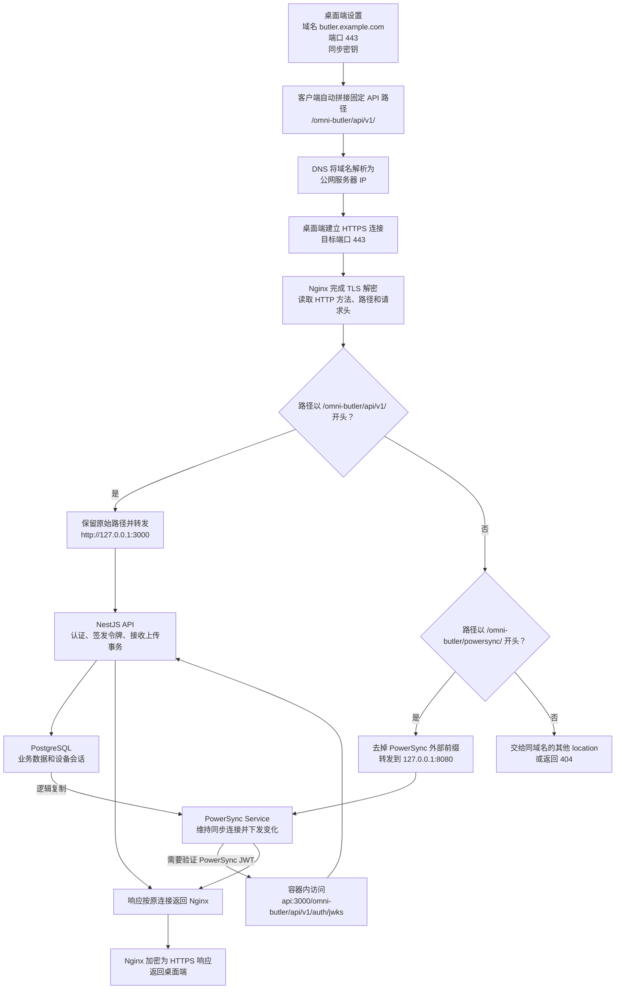

# Docker Compose 部署

在 `deploy/` 目录执行以下命令。Compose 会统一管理 PostgreSQL、API、PowerSync 和 MinIO 的网络、数据卷、启动顺序和健康检查。

## 准备

安装 Docker 和 Compose 插件（建议 v2.24.4 或更新版本；不要使用旧版 Python `docker-compose`）。首次部署将 `.env.example` 复制为 `.env`（PowerShell 使用 `Copy-Item .env.example .env`，CMD 使用 `copy .env.example .env`，Bash 使用 `cp .env.example .env`），已有 `.env` 时直接编辑，不要覆盖。

配置统一填写在 `.env` 中：

| 配置 | 用途 |
| --- | --- |
| `POSTGRES_PASSWORD` | 数据库密码，使用较长的随机字母数字串 |
| `SYNC_SECRET` | 客户端连接密钥，至少 16 个字符 |
| `API_HOST_PORT` | API 的宿主机映射端口，默认 `3000` |
| `POWERSYNC_HOST_PORT` | PowerSync 的宿主机映射端口，默认 `8080` |
| `PUBLIC_BASE_URL` | 同域名 HTTPS 公网根地址，例如 `https://butler.example.com`；后端自动推导同步与取音地址 |
| `ASSISTANT_ATTACHMENTS_ENABLED` | 助手文件附件开关，默认 `false`；升级附件迁移及API后按需开启 |
| `IMAGE_SYNC_ENABLED` | 图片业务开关，默认 `false`；MinIO 始终运行，供笔记原音使用 |
| `AI_DNS_MODE` | 模型解析模式，默认 `system` 使用容器/VPC DNS；`doh` 需显式配置解析器 |

Compose 自动读取当前目录的 `.env`，容器内部端口固定为 `3000`、`8080`。已有 `.env` 时补上 `API_HOST_PORT=3000`、`POWERSYNC_HOST_PORT=8080`，或填写自己的映射端口。

API 和 PowerSync 的公网路径固定为 `/omni-butler/api/v1/`、`/omni-butler/powersync/`，不需要也不能通过 `.env` 或客户端设置修改。

`PUBLIC_BASE_URL` 可带端口或末尾 `/`，但不能含账号密码、额外路径、查询参数或片段。独立覆盖属于高级选项：`POWERSYNC_PUBLIC_URL` 经 Compose 映射为后端 `POWERSYNC_URL`，`NOTE_ASR_PUBLIC_URL` 保留原名；非空覆盖优先，空值使用基础地址推导。非法非空配置会拒绝启动，不会回退到其他地址。

旧配置仍然有效。升级后若采用 `PUBLIC_BASE_URL`，应删除或注释旧的 `POWERSYNC_PUBLIC_URL` 和 `NOTE_ASR_PUBLIC_URL`，否则旧值继续优先。只设置基础地址不会启用腾讯识别，仍需单独配置识别厂商和凭证。

## 启动

API 容器启动时先执行 `prisma migrate deploy`，成功后启动服务。首次部署会按顺序应用仓库中的全部迁移；已有部署的升级顺序和兼容要求见下方“版本升级”。应用内助手默认关闭，在 AI 设置中独立选择模型配置；助手私有表与 `assistant_graph` checkpoint 不加入 PowerSync。

完整数据库灾备恢复时，保持 API 停止，恢复数据库及 `api-keys` 等全部持久卷后，先在恢复库执行 [assistant-restore-safety.sql](assistant-restore-safety.sql)，再启动 API。脚本保留业务记录、聊天、记忆、回执与同步保护，禁用助手并撤销旧设备/MCP身份及未完成操作；设备需重新连接。不能直接启动恢复出来的旧排队任务或沿用备份中的确认授权。助手 API、分批、上下文和验证边界见 [助手 README](../apps/server/src/assistant/README.md)。

配置完成后，Windows PowerShell、CMD 和 Linux / macOS 均使用同一条命令：

```text
docker compose up -d --build --wait
```

局域网直连时，注释或删除 `PUBLIC_BASE_URL`，允许 API 和 PowerSync 使用不同的 HTTP 端口。例如：

```dotenv
API_HOST_PORT=9000
POWERSYNC_HOST_PORT=9080
POWERSYNC_PUBLIC_URL=http://192.168.1.10:9080
```

客户端服务器地址填写 `192.168.1.10`，API 端口填写 `9000`。端口映射不会自动修改对外 URL；最终必须有一个 PowerSync 地址。未配置 ASR 公网地址时，小文件继续使用内联识别，超过 5MB 的文件会提示缺少公网地址。公网部署按下面的 Nginx 章节调整 `.env`。

如果之前在终端设置过同名端口变量，请清除它们或打开一个未设置这些变量的新终端；终端环境变量的优先级高于 `.env`。

## 版本升级

升级前暂停客户端写入，完整备份 PostgreSQL、MinIO 数据与凭证、API 密钥，以及客户端本机数据和草稿原音。停止旧 API 后，更新代码并执行 `docker compose up -d --build --wait`；确认数据库迁移、API 与仓库配套的 `powersync/sync-config.yaml` 可用，再升级全部参与同步的客户端。不要删除数据库或 PowerSync 卷来绕过版本不兼容。

不同版本号的用途独立，不能互换：

| 用途 | 当前值 | 代码入口 |
| --- | --- | --- |
| 客户端 SQLite 结构 | 26 | `apps/client/lib/core/database/app_database.dart` |
| 客户端/API 同步门禁 | 12 | `apps/server/src/sync/sync-schema.ts` |
| 本机备份快照 | 11（可读取 1–10） | `apps/client/lib/core/sync/sync_snapshot.dart` |
| 换服请求协议 | 3 | 同上 `migrationProtocolVersion` |

从旧部署升级时，需了解以下会影响数据的兼容行为：

- `20261011000000_remove_event_description` 删除事件 `description` 及其旧内容，保留 `notes` 备注、事件主体和历史。备份后再执行迁移。
- `20261012000000_remove_note_categories` 退休笔记类别及关联，其他模块类别不变。服务端适配旧上传请求时保留原事务身份和原始负载摘要；新版不重新创建笔记类别。
- 笔记图片、记录时间和置顶需要配套的数据库迁移及 PowerSync 下行字段，包括 `note_images`、`record_time_seconds`、`record_utc_offset_minutes` 和 `is_pinned`。笔记正文仍保存在 `note_entries.body`，不批量改写历史 Markdown。
- 本机草稿和原件属于设备备份，不进入换服的业务请求；选择使用服务器数据时，旧草稿保留在旧数据源和备份中。
- 同步门禁拒绝旧客户端时，保留离线数据和上传队列，升级客户端与服务端后再连接。

## 模型出站网络

大陆云服务器推荐保留 `AI_DNS_MODE=system`，使模型域名沿用容器配置的 DNS，上游使用云厂商推荐的 VPC DNS。Docker 自定义网络通常通过 `127.0.0.11` 转发外部查询；这个地址是容器内的解析入口，实际可用性仍取决于宿主机/云网络的上游配置。不要在服务器上照搬开发机的代理 DNS 或 Fake-IP 配置。相关行为见 [Docker DNS 文档](https://docs.docker.com/engine/network/#dns-services)。

配置在 API 启动时校验，只有以下两种显式模式；不会因为一个模式失败而偷偷切换到另一个模式：

| 配置 | 默认值 | 说明 |
| --- | --- | --- |
| `AI_DNS_MODE` | `system` | `system` 或 `doh`，不按智谱/DeepSeek 等模型供应商分支 |
| `AI_DNS_SERVERS` | 空 | `system` 下可填最多四个逗号分隔的 DNS IP；空值读取容器 DNS；可使用受信 VPC 内网 IP |
| `AI_DOH_RESOLVERS` | 空 | `doh` 下必填 JSON 列表，最多四个；每项包含 `id`、`url`、`bootstrapAddresses` |
| `AI_DNS_TIMEOUT_MS` | `5000` | 整个解析过程的总预算，范围 1–30000 毫秒 |
| `AI_DNS_ATTEMPT_TIMEOUT_MS` | `2000` | 单次解析器尝试预算，不得超过解析总预算 |
| `AI_CONNECT_TIMEOUT_MS` | `8000` | 全部候选 IP 的建连总预算，范围 1–60000 毫秒 |
| `AI_CONNECT_ATTEMPT_TIMEOUT_MS` | `2000` | 单个 IP 的建连预算，不得超过建连总预算 |
| `AI_CONNECT_MAX_ADDRESSES` | `8` | 最多尝试的候选 IP 数，范围 1–32；公网校验仍覆盖全部返回地址 |

显式配置 `AI_DNS_SERVERS` 只影响模型解析，不改变 PostgreSQL、MinIO 等容器服务名解析。填写云厂商实际提供的 DNS 地址，不能把另一家云的私网 DNS 当作通用地址。`doh` 模式要求 `AI_DNS_SERVERS` 为空；`system` 模式要求 `AI_DOH_RESOLVERS` 为空。

本地存在 Fake-IP 或部署明确要求加密 DNS 时，可在 `.env` 中选择 DoH。例如下面使用 AliDNS 的两个引导地址；它们属于同一解析服务，并不等于两个独立供应商：

```dotenv
AI_DNS_MODE=doh
AI_DNS_SERVERS=
AI_DOH_RESOLVERS='[{"id":"alidns","url":"https://dns.alidns.com/dns-query","bootstrapAddresses":["223.5.5.5","223.6.6.6"]}]'
```

DoH 使用标准 `application/dns-message` 报文，不使用不同供应商的 JSON 方言。端点必须是无凭据、查询参数和片段的 HTTPS 地址；引导 IP 必须为公网地址且保留端点域名的 TLS 验证。添加备用服务前，应在实际容器网络中验证其可达性；Cloudflare 仅适合作为已验证可达的显式选项，大陆生产默认配置不依赖它。配置发生超时或临时网络错误才会尝试后备路径，私网答案、证书错误、损坏应答与用户取消不会通过切换路径绕过。

测试连接、笔记整理和助手流式请求使用同一套地址校验及安全连接：解析完成后检查全部 A/AAAA 地址，合法空 AAAA 允许，查询超时不视为空记录；混入任何内网、保留地址或 Fake-IP 时整体拒绝。模型连接固定到已验证的 IP，同时验证原主机名证书并保留 SNI/Host，禁止重定向。首 IP 不可达时可以在 HTTP 发送前尝试下一 IP，最终复用已建立的同一条 TLS 连接发送模型请求；发送开始后断线、超时或断流不会由网络层自动重发。配置中的各阶段预算仍受业务请求的剩余总时间限制，不会因切换而重新获得完整预算。

### 在 API 容器内诊断

构建产物包含无凭据诊断命令。对正在运行的 API，执行：

```text
docker compose exec -T api node dist/ai/ai-network-diagnose.js https://api.deepseek.com https://open.bigmodel.cn/api/v1
```

命令读取容器当前的网络环境变量，只执行 DNS、公网校验和 TLS 握手，随后关闭连接；不读取模型 Key、不发送模型 HTTP 请求、不修改模型设置或业务数据。可传 1–8 个模型基址，单个地址最长 2048 字符。输出是一个 JSON 报告，`scope` 固定为 `dns-tls-only`；退出码 `0` 表示全部目标通过，非零表示至少一项失败。

报告展示实际 DNS 模式、解析器地址、阶段耗时、候选 IP、受控原因码及 `traceId`。`systemDnsSource=container` 表示使用容器提供的 DNS；若显示 `127.0.0.11`，进一步核对 Docker/宿主机的云 DNS 上游。无效 URL 只报告参数序号，不回显其中的凭据；模型请求路径、Key 和正文不会进入报告。排查时不要整份输出容器环境变量或已展开的 Compose 配置，以免暴露其他服务凭据。

确认容器到所选 DNS 的 UDP/TCP 53（system）或 TCP 443（DoH）出口、到模型服务的 HTTPS 出口、容器 CA 证书与宿主机时间均正常。模型连接采用固定 IP 直连；设置 `HTTPS_PROXY` 不等于已经支持代理出站。若网络必须经过代理，应先明确代理的目标 IP 与 TLS 校验边界，再实现和验收代理模式。

这项诊断成功不代表 Key 有效、模型支持 Responses 或工具调用可用。网络通过后，再在客户端执行最小连接测试、用合成短文本测试笔记整理，并验证助手完整流式回答。真实模型调用可能计费。外部解析器/模型故障不直接使 API 存活检查失败，避免无效重启影响同步和笔记功能。

### 更新、验收与回退

网络改造本身不增加数据库迁移。上线前先核对运行镜像对应的代码版本和已有迁移状态；跨版本升级仍执行本文件的备份与升级流程。保存旧 API 镜像的不可变标签、原 Compose 配置和 `.env`，不要在构建候选镜像时覆盖唯一的回退镜像。

先构建候选 API 镜像，通过候选配置运行相同的只读诊断命令。使用当前 Compose 构建时，下列命令只启动一次诊断容器，覆盖镜像默认启动命令，不运行数据库迁移或 API worker：

```text
docker compose build api
docker compose run --rm --no-deps api node dist/ai/ai-network-diagnose.js https://api.deepseek.com https://open.bigmodel.cn/api/v1
```

自动化测试与候选容器验收通过后，仅更新 API：

```text
docker compose up -d --no-deps --wait api
```

切换后重新执行运行容器诊断，再验证三个业务入口。若失败，恢复旧网络配置，通过临时 Compose override 将 `api.image` 指向保存的旧镜像标签，并使用 `up -d --no-deps --no-build --wait api` 恢复；再次核对健康状态和业务行为。不要使用 `down -v`，也不要为网络故障清理业务数据卷。

发布门禁包含以下故障注入；只在隔离测试或候选容器执行网络阻断，不在运行中的业务容器临时改防火墙：

| 场景 | 必须观察到的结果 |
| --- | --- |
| Cloudflare 不可达，默认 system 模式 | 沿用容器/VPC DNS，正常完成连接 |
| 主解析器超时、备用可用 | 在总预算内恢复，没有重复模型 POST |
| 所有解析器不可达 | 有界失败、阶段原因明确、模型请求为零 |
| A 有记录、AAAA 无记录或超时 | 无记录可继续；超时按配置恢复或明确失败，不吞掉不完整结果 |
| 首模型 IP 建连失败，下一 IP 正常 | 仅在成功连接上发送一次模型请求 |
| 混合公网/私网、Fake-IP、非法 CNAME 或证书 | 拒绝出站，不发送凭据 |
| DNS/TLS 期间取消 | 关闭在途资源，不产生迟到请求 |
| 模型 POST 后断线或 SSE 中断 | 保留未知提交事实，不由网络层自动重发 |
| 测试连接、笔记整理、助手 SSE | 共同使用相同的安全网络规则 |

## 可选图片同步

只需在 `.env` 中设置 `IMAGE_SYNC_ENABLED=true`，再执行上面的 `docker compose up -d --build --wait`。只接受小写 `true` 或 `false`，已有部署未填写该项时默认关闭。MinIO 使用固定版本的官方镜像，作为笔记与图片共用的常驻对象存储，不受图片开关影响。

MinIO 启动时自动生成随机内部凭证并保存在 `image-storage-credentials` 卷，API 按需初始化独立私有桶：图片为 `omni-butler-images`，笔记原音为 `omni-butler-note-audio`。两类对象都保存在现有 `image-storage-data` 卷。无需填写存储密钥、域名、端口、profile 或额外启动参数；客户端通过原有认证 API 上传下载，MinIO 不映射宿主机端口，浏览器管理界面关闭。

同步范围为物品、会员主图和笔记图片，首页背景仍只保存在各自设备。开启后客户端会补传本机已有图片，服务端已有的图片优先；新设备下载后的缓存离线仍可查看。图片传输失败可重试，不影响业务记录保存。服务器迁移只复制当前设备实际持有的图片，缺失文件会提示，不阻止业务数据迁移。

改回 `IMAGE_SYNC_ENABLED=false` 并执行相同启动命令，只停止图片传输；MinIO 和笔记音频继续可用，服务器对象、凭证及客户端本机图片都保留。再次改为 `true` 会复用原凭证和图片。首次从带 `image-credentials` 辅助容器的旧版本升级时，执行 `docker compose up -d --build --wait --remove-orphans` 删除已停用的旧容器；后续无需该参数。不要手动删除凭证卷，否则现有存储身份无法自动恢复。

本项目固定使用 MinIO 官方镜像 `minio/minio:RELEASE.2025-09-07T16-13-09Z`，并同时固定镜像摘要 `sha256:14cea493d9a34af32f524e538b8346cf79f3321eff8e708c1e2960462bd8936e`。它只面向容器内的 API，不额外公开 S3 端口或控制台。该版本存在未签名流式请求相关的已知风险；本项目的 API 只使用带签名的 S3 请求，当前使用场景接受该风险。

固定版本若无法从镜像仓库拉取，可从已持有该官方镜像的可信机器导出并导入；不要改回 `latest`，也不要使用来源不明的同名镜像：

```text
docker tag minio/minio@sha256:14cea493d9a34af32f524e538b8346cf79f3321eff8e708c1e2960462bd8936e minio/minio:RELEASE.2025-09-07T16-13-09Z
docker save -o minio-RELEASE.2025-09-07T16-13-09Z.tar minio/minio:RELEASE.2025-09-07T16-13-09Z
docker load -i minio-RELEASE.2025-09-07T16-13-09Z.tar
```

## 公网部署：Nginx + HTTPS

使用一个域名访问 API 和 PowerSync，Nginx 直接安装在 Docker 所在的 Linux 宿主机上。

- 将 `butler.example.com` 替换为自己的域名，并解析到服务器公网 IP。
- 安装 Nginx，提前签发有效证书，准备完整证书链和私钥。
- 在服务器安全组和防火墙中允许访问 `80`、`443`。

在 `.env` 中确认或修改以下三项：

```dotenv
API_HOST_PORT=127.0.0.1:3000
POWERSYNC_HOST_PORT=127.0.0.1:8080
PUBLIC_BASE_URL=https://butler.example.com
```

端口配置支持 `监听地址:端口` 格式。上述配置将后端端口绑定到宿主机回环地址，公网请求统一经过 Nginx。保存后执行同一条 `docker compose up -d --build --wait`。

后端自动生成 `https://butler.example.com/omni-butler/powersync/` 和 `https://butler.example.com/omni-butler/api/v1`。如果确实需要不同域名，可独立覆盖：

```dotenv
POWERSYNC_PUBLIC_URL=https://sync.example.com/omni-butler/powersync/
NOTE_ASR_PUBLIC_URL=https://audio.example.com/omni-butler/api/v1
```

覆盖地址仍遵循各服务原有路径校验；ASR 地址必须为腾讯能访问的 HTTPS 地址。

### Nginx 配置

将以下内容保存到 `/etc/nginx/conf.d/omni-butler.conf`，确认该目录由 `nginx.conf` 的 `http` 块加载。替换域名和证书路径；示例证书路径不会自动生成证书。

API 和 PowerSync 分别固定使用 `/omni-butler/api/v1/`、`/omni-butler/powersync/`。两个前缀互不重叠，也不会占用当前域名的根路径，方便同一台 Nginx 继续部署其他服务。基础地址自动包含这些前缀；若独立覆盖 PowerSync 地址，必须保留固定路径和末尾 `/`。

```nginx
# 按请求决定是否升级为 WebSocket。
map $http_upgrade $omni_connection_upgrade {
    default upgrade;
    ''      close;
}

server {
    listen 80;
    server_name butler.example.com;

    return 308 https://butler.example.com$request_uri;
}

server {
    listen 443 ssl;
    server_name butler.example.com;

    # 替换为实际证书链和私钥文件。
    ssl_certificate     /etc/letsencrypt/live/butler.example.com/fullchain.pem;
    ssl_certificate_key /etc/letsencrypt/live/butler.example.com/privkey.pem;
    ssl_protocols TLSv1.2 TLSv1.3;

    # 与后端允许的上传大小一致。
    client_max_body_size 32m;

    proxy_http_version 1.1;
    proxy_set_header Host $host;
    proxy_set_header X-Real-IP $remote_addr;
    proxy_set_header X-Forwarded-For $proxy_add_x_forwarded_for;
    proxy_set_header X-Forwarded-Proto $scheme;
    proxy_set_header Upgrade $http_upgrade;
    proxy_set_header Connection $omni_connection_upgrade;
    # 如果上游启用了响应压缩，可取消注释以请求未压缩内容。
    # proxy_set_header Accept-Encoding "";

    # 助手实时语音：五分钟录音及最终转写等待，保留完整 API 路径。
    location = /omni-butler/api/v1/assistant/speech/stream {
        proxy_pass http://127.0.0.1:3000;
        proxy_http_version 1.1;
        # 此段可单独用于已有站点，完整声明请求头，不依赖 server 层继承。
        proxy_set_header Host $host;
        proxy_set_header X-Real-IP $remote_addr;
        proxy_set_header X-Forwarded-For $proxy_add_x_forwarded_for;
        proxy_set_header X-Forwarded-Proto $scheme;
        proxy_set_header Upgrade $http_upgrade;
        proxy_set_header Connection "upgrade";
        proxy_set_header Authorization $http_authorization;
        proxy_buffering off;
        proxy_cache off;
        proxy_read_timeout 360s;
        proxy_send_timeout 360s;
    }

    # API：保留客户端已经拼接的完整接口路径。
    location ^~ /omni-butler/api/v1/ {
        proxy_pass http://127.0.0.1:3000;

        # SSE：关闭响应缓冲、缓存及临时响应文件。
        proxy_buffering off;
        proxy_cache off;
        proxy_max_temp_file_size 0;

        # 保留 HTTP/1.1 分块传输，并减少小包延迟。
        chunked_transfer_encoding on;
        tcp_nodelay on;

        # 关闭 Nginx 响应压缩，避免额外的压缩缓冲延迟。
        gzip off;

        # 为上游连接、请求发送和 SSE 响应读取分别设置超时。
        proxy_connect_timeout 60s;
        proxy_send_timeout 600s;
        proxy_read_timeout 86400s;
    }

    # PowerSync 基础路径缺少末尾斜杠时，保留请求方法并补上斜杠。
    location = /omni-butler/powersync {
        return 308 /omni-butler/powersync/;
    }

    # PowerSync：去掉外部路径前缀后转发，并关闭响应缓冲。
    location ^~ /omni-butler/powersync/ {
        proxy_pass http://127.0.0.1:8080/;
        proxy_buffering off;
        proxy_cache off;
        proxy_read_timeout 3600s;
        proxy_send_timeout 3600s;
    }
}
```

API 的 `proxy_pass` 后没有 URI，因此完整 API 路径会原样交给 NestJS。PowerSync 的 `proxy_pass` 末尾必须保留 `/`，Nginx 才会把外部 `/omni-butler/powersync/` 替换成容器能够识别的根路径 `/`。未匹配这两个前缀的请求不会进入 Omni Butler，可继续由其他 `location` 处理；没有其他匹配时由 Nginx 返回默认响应。若修改了后端映射端口，也要修改对应的 `proxy_pass` 端口。Nginx 若运行在另一个容器里，`127.0.0.1` 指向 Nginx 容器自身，不能直接照用此配置。

API 路径包含助手 SSE 流，因此关闭响应缓冲和压缩。`proxy_max_temp_file_size 0` 只禁止代理响应写入临时文件，不影响上传请求体的缓冲；`proxy_read_timeout 86400s` 是连续两次上游读取之间的超时，不是模型任务执行时限。`gzip off` 只关闭 Nginx 的压缩；若上游也启用了压缩，可取消上方公共请求头中的 `Accept-Encoding` 注释。该指令与其他 `proxy_set_header` 保持在同一层，避免单独加到 `location` 后丢失原有请求头继承。详见 [Nginx 代理模块](https://nginx.org/en/docs/http/ngx_http_proxy_module.html#proxy_set_header)。

### 实时语音连接验收

已有站点可单独加入上方精确匹配的语音 `location`，将示例 `3000` 改为 API 实际映射端口。该段已包含全部转发请求头，不依赖公共 `map`；只拷贝 `proxy_pass` 或关闭 SSE 缓冲不能完成 WebSocket 升级。Nginx 不会自动向上游转发 `Upgrade` 和 `Connection`，见 [WebSocket 代理文档](https://nginx.org/en/docs/http/websocket.html)。修改前备份实际生效的站点配置，先执行 `nginx -t`，通过后再 reload。

替换为实际域名后，使用不带令牌的握手探针：

```bash
curl --http1.1 -i --max-time 10 \
  -H 'Connection: Upgrade' \
  -H 'Upgrade: websocket' \
  -H 'Sec-WebSocket-Version: 13' \
  -H 'Sec-WebSocket-Key: dGhlIHNhbXBsZSBub25jZQ==' \
  https://butler.example.com/omni-butler/api/v1/assistant/speech/stream
```

正确到达语音网关后，缺少设备令牌会返回空正文 `401`，不会连接腾讯 ASR。将同一探针的地址换成服务器本机 `http://127.0.0.1:实际端口/omni-butler/api/v1/assistant/speech/stream` 对比；若直连为 `401`、公网为 `404`，应检查精确路由、路径转发及升级请求头是否生效。这里的 `401` 只验证请求到达鉴权入口，不代表 ASR 配置或识别已成功。

最后通过客户端使用有效设备会话完成一次短语音验收：握手 `101` 后收到 `ready`，录音文字持续更新，手动结束后得到 `completed`。服务端须配置 `NOTE_ASR_PROVIDER=tencent`、数字 `TENCENT_ASR_APP_ID` 和有效的腾讯云密钥；不要把令牌或腾讯签名 URL 放进查询参数、命令行或日志。真实识别可能计费。

### 桌面端如何访问公网服务

桌面端设置只填写以下三项，API 路径由应用自动拼接：

| 输入项 | 填写内容 |
| --- | --- |
| 服务器地址 | `butler.example.com` |
| 端口 | `443` |
| 同步密钥 | 与服务器 `.env` 中的 `SYNC_SECRET` 一致 |

公网域名默认使用 HTTPS，因此客户端会拼出 API 根地址 `https://butler.example.com:443/omni-butler/api/v1`；HTTPS 默认端口为 `443`，URL 中也可以省略。客户端不会直接访问公网的 `3000` 或 `8080`；这两个端口只允许同一台服务器上的 Nginx 访问。

| 网络入口 | 谁访问 | 作用 |
| --- | --- | --- |
| 公网 `443` | 桌面端 | 唯一的 HTTPS 业务入口，由 Nginx 监听 |
| 公网 `80` | 浏览器或误用 HTTP 的客户端 | Nginx 返回 `308`，要求改用 HTTPS；正常桌面端连接不需要先访问它 |
| `127.0.0.1:3000` | 服务器本机的 Nginx | Docker 映射到 API 容器的 `3000` |
| `127.0.0.1:8080` | 服务器本机的 Nginx | Docker 映射到 PowerSync 容器的 `8080` |



一次首次连接和后续同步大致经过以下步骤：

1. 客户端向 `POST https://butler.example.com/omni-butler/api/v1/auth/connect` 发送同步密钥。Nginx 匹配 API 专用 `location`，把原始路径转发到 `127.0.0.1:3000`。
2. API 校验密钥、在 PostgreSQL 中创建该设备的会话，返回短期访问令牌和设备凭证。
3. 客户端携带访问令牌请求 `POST /omni-butler/api/v1/auth/powersync-token`。API 返回 PowerSync 短期 JWT 和后端解析后的同步地址，本例由 `PUBLIC_BASE_URL` 推导为 `https://butler.example.com/omni-butler/powersync/`。
4. PowerSync SDK 在这个地址后追加 `sync/stream` 等协议路径。Nginx 匹配 `/omni-butler/powersync/`，去掉外部前缀，再把 `/sync/stream` 转发到 `127.0.0.1:8080`。
5. PowerSync 从 PostgreSQL 的逻辑复制流获得服务端变化并下发。桌面端的本地修改则由客户端整理成事务，再通过 `POST /omni-butler/api/v1/sync/operations` 上传给 API，最终写入 PostgreSQL。

同步密钥在连接预检、创建会话和显式迁移（含查询原迁移回执）时通过 HTTPS 请求体发送。普通业务 API 请求使用短期 Bearer Token；设备凭证只用于刷新令牌或断开会话。

Nginx 的分流依据是 URL 路径：`/omni-butler/api/v1/` 交给 API，`/omni-butler/powersync/` 交给 PowerSync，其他路径留给同域名上的其他服务。它不会解析请求 JSON 来选择服务。`Host`、`X-Real-IP`、`X-Forwarded-For`、`X-Forwarded-Proto` 等请求头也会一并传递。

首次连接请求的 HTTP 格式如下，JSON 中的密钥仅为示意：

```http
POST /omni-butler/api/v1/auth/connect HTTP/1.1
Host: butler.example.com
Content-Type: application/json

{
  "syncKey": "替换为服务器配置的同步密钥"
}
```

认证成功后的 API 请求使用 Bearer Token，例如获取 PowerSync 凭证：

```http
POST /omni-butler/api/v1/auth/powersync-token HTTP/1.1
Host: butler.example.com
Authorization: Bearer <accessToken>
Content-Length: 0
```

本地数据变更以一个完整事务上传，格式示例如下：

```http
POST /omni-butler/api/v1/sync/operations HTTP/1.1
Host: butler.example.com
Authorization: Bearer <accessToken>
Content-Type: application/json

{
  "clientId": "客户端数据库安装 UUID",
  "transactionId": "本地事务 ID",
  "operations": [
    {
      "op": "PATCH",
      "table": "todo_items",
      "id": "待办记录 UUID",
      "data": {
        "title": "修改后的标题"
      }
    }
  ]
}
```

这两个路径是服务协议的一部分，请保持 Nginx 配置不变。公网部署将示例域名和 `PUBLIC_BASE_URL` 替换为自己的域名；若使用独立 PowerSync 覆盖，确保地址以 `/omni-butler/powersync/` 结尾。

检查并加载配置（使用 systemd 的 Linux）：

```bash
sudo nginx -t && sudo systemctl reload nginx
```

验证两个服务的公网入口：

```bash
curl -f https://butler.example.com/omni-butler/api/v1/health
curl -f https://butler.example.com/omni-butler/powersync/probes/liveness
```

证书到期前需要续期并重新加载 Nginx。配置指令可查阅 [Nginx HTTPS](https://nginx.org/en/docs/http/configuring_https_servers.html)、[反向代理](https://nginx.org/en/docs/http/ngx_http_proxy_module.html)及 [WebSocket](https://nginx.org/en/docs/http/websocket.html) 官方文档。

## 客户端连接

在设置中开启“多端数据同步”：

| 输入项 | 局域网示例 | 上述 Nginx 公网示例 |
| --- | --- | --- |
| 服务器地址 | `192.168.1.10` | `butler.example.com` |
| 端口 | `3000` | `443` |
| 同步密钥 | `.env` 中的 `SYNC_SECRET` | `.env` 中的 `SYNC_SECRET` |

地址栏只填写 IP 或域名，端口单独填写。客户端会自动拼接固定 API 路径 `/omni-butler/api/v1/`；局域网 IP 默认 HTTP，公网地址默认 HTTPS，局域网也使用 HTTPS 时可填写 `https://192.168.1.10`。PowerSync 完整地址由后端下发，用户无需填写同步路径。

## 查看、停止与更新

查看状态和日志：

```text
docker compose ps
docker compose logs -f api powersync
```

停止实例，保留容器和数据：

```text
docker compose stop
```

重新启动、更新代码或修改 `.env` 后，执行 `docker compose up -d --build --wait`。Compose 会重新读取配置、构建镜像并按需重建容器，数据卷保留；更改已初始化数据库的密码还必须修改数据库内的角色密码，仅修改 `.env` 不会生效。

## 数据与备份

笔记正文和原音元数据要求客户端与服务器通过相同的同步门禁，版本定义见“版本升级”。语音服务商密钥只配置在部署 `.env`：设置 `NOTE_ASR_PROVIDER=tencent`、`TENCENT_ASR_SECRET_ID`、`TENCENT_ASR_SECRET_KEY`；普通文本和本地录音不需要这些密钥。腾讯 API 3.0 不使用 APP_ID 参与签名。云端识别在用户授权后才提交。

AI 助手的麦克风输入使用腾讯云[实时语音识别 WebSocket](https://cloud.tencent.com/document/api/1093/48982)，共用上述凭据，并要求 `TENCENT_ASR_APP_ID` 为同一腾讯云账号的数字 APPID。缺少 APPID 只会禁用实时输入，不影响文件识别与 API 启动；还需在腾讯云开通实时语音识别并具备可用额度。实时输入固定 `16k_zh`、16kHz 单声道 16-bit PCM，不受 `NOTE_ASR_MODEL` 控制，也不需要 `NOTE_ASR_PUBLIC_URL`。服务端桥接 `/omni-butler/api/v1/assistant/speech/stream`，凭据和腾讯签名 URL 始终保留在服务端。反向代理必须透传 WebSocket Upgrade 和 Authorization，并应用上方语音路径的 360 秒超时。

每次录音最多五分钟，同设备最多一路、同 owner 最多两路（单 API 实例计数）；只有收到厂商最终完成回执才结束识别。网络中断或取消会关闭两端连接，不自动新建付费识别；原音只在连接中流转，不落盘、不生成笔记或助手消息。是否自动发送识别文字是客户端本机设置，默认关闭。升级顺序为先更新 API 和代理配置，再更新客户端；首次实际验收分别检查 Windows、Android 麦克风权限、实时文字、手动结束、断网以及自动发送开关。仓库测试只连接本地模拟厂商，不验证真实腾讯云额度或设备录音。

长录音识别使用 `PUBLIC_BASE_URL=https://自己的域名` 推导的 API 地址，或高级覆盖 `NOTE_ASR_PUBLIC_URL=https://自己的域名/omni-butler/api/v1`，该 HTTPS 地址必须能被腾讯访问。服务器签发绑定任务的短期私有原音链接；腾讯本地文件方式上限为 5MB，超过该大小且未配置公网地址时会明确提示。Nginx 的 API `location` 需设置 `client_max_body_size 128m;`，允许完整原音与迁移暂存上传；`proxy_read_timeout` 沿用上方 SSE 示例的 `86400s`。

笔记新增原音及迁移暂存音频统一进入 MinIO 私有桶 `omni-butler-note-audio`，不再使用服务器音频目录或 `note-audio-data` 挂载。存储失败保留重试和清理回执，不回退写磁盘。客户端继续保留本机录音及缓存，支持离线使用。完整迁移先以部署同步密钥暂存原音，服务器迁移协议 v3 在同一事务验证并接管正式原音资产；只有用户明确确认缺失文件后才能使用省略清单。回收站保留 30 天，永久删除经持久文件清理队列执行。参见[原音接口与识别说明](../apps/server/src/notes/README.md)。

若旧部署使用磁盘原音，升级前必须制定并验证迁入 MinIO 的方案，不能直接移除旧文件。

客户端更换服务器需先升级目标后端：在目标部署目录执行上面的 `docker compose up -d --build --wait`，启动会应用新增的迁移回执表，不会清空现有数据。PowerSync 至少需要 1.24.0 的检查点请求接口，仓库固定镜像为 1.25.0。再升级客户端，从「设置 → 数据同步 → 更换服务器」预检并选择数据来源。

选择以本机覆盖时，客户端发送经过确认的完整快照，后端一次事务替换目标业务数据及同步 owner；不需要删除 PowerSync 存储、复制槽或 Docker 卷。原目标设备会话失效，其他旧设备重新连接时应选择使用服务器数据。迁移发生故障时在同一客户端继续原迁移，不要通过删库、换密钥或重新建部署来处理暂时的网络超时。详见[客户端迁移与验证说明](../apps/client/README.md)。

`compose.migration-test.yml` 仅供开发隔离测试，使用固定公开测试凭证、回环端口 35430/35480/35439 和 `omni-migration-e2e` 项目名，不可作为正式部署配置。

业务库和同步状态保存在 `postgres-data` 卷，签名私钥保存在 `api-keys` 卷。实际卷名带 Compose 项目前缀；保持部署目录和项目名不变，不要使用 `docker compose down -v` 删除数据卷。

无论图片同步是否开启，完整备份都必须包含 PostgreSQL、`image-storage-data` 和 `image-storage-credentials`，并保留上面的 `api-keys`。停止 API/PowerSync 写入和 MinIO 后，将这些卷作为同一批备份保存；只备份 PostgreSQL 无法恢复原音或图片，只备份数据卷无法恢复存储凭证。恢复时使用同一批数据库、对象数据、凭证与签名私钥，保持 API 停止并执行前述 `assistant-restore-safety.sql` 后再启动服务。凭证文件权限为 `0600`，只允许 API 用户和 MinIO 的 root 进程读取；不要把凭证内容放入日志或提交仓库。

`compose.notes-storage-test.yml` 仅用于 `omni-notes-storage-test` 隔离项目，公开测试配置为 `.env.notes-storage-test.example`。回环端口为 PostgreSQL 55449、MinIO 55490、API 55430、PowerSync 55480；正式配置没有 MinIO 端口映射。从仓库根目录仅启动测试存储：

```text
docker compose -p omni-notes-storage-test --env-file deploy/.env.notes-storage-test.example -f deploy/docker-compose.yml -f deploy/compose.notes-storage-test.yml up -d --wait postgres minio
```

`compose.image-test.yml` 为图片同步隔离测试覆盖配置，只能使用 `-p omni-image-test` 并同时传入 `-f docker-compose.yml -f compose.image-test.yml`；使用回环测试端口 35530/35580/35539，MinIO 仅在测试覆盖配置中映射 35590，调用方必须显式提供测试密码和同步密钥，禁止复用正式 `.env`。

从仓库根目录启动隔离环境（`.env.image-test.example` 仅含公开测试凭证）：

```text
docker compose -p omni-image-test --env-file deploy/.env.image-test.example -f deploy/docker-compose.yml -f deploy/compose.image-test.yml up -d --build --wait
```

单独备份业务库和私钥（Bash）：

```bash
docker compose exec -T postgres pg_dump -U omni_butler omni_butler > backup.sql
docker compose cp api:/app/keys ./api-keys-backup
```

API 文档：局域网为 `http://<服务器IP>:<API端口>/omni-butler/api/v1/docs`，上述公网部署为 `https://butler.example.com/omni-butler/api/v1/docs`。接口细节见 [服务端说明](../apps/server/README.md)。


## 大模型设置与笔记 AI 整理

模型配置和持久任务为后端私有表，不加入 PowerSync publication 或 bucket 查询。部署时应用仓库全部增量迁移，升级顺序见“版本升级”。

首次保存模型 Key 时在 `/app/keys/ai-encryption-key-v1` 生成独立加密密钥，使用现有 `api-keys` 持久卷，不需新增供应商环境变量。启动后从“设置 → AI 设置”填写供应商、Base URL、模型和 Key，测试并保存；首个模型自动设为当前使用，开启整理直接提交。第三方服务必须为公网 HTTPS；不接受 localhost、内网或重定向地址。

### Responses API 配置

模型连接与笔记整理只使用 `POST {baseUrl}/responses`，无Chat Completions回退。智谱预设为 `https://open.bigmodel.cn/api/v1` / `glm-5.3`，DeepSeek预设为 `https://api.deepseek.com` / `deepseek-flash`；自定义服务必须支持Responses。基址可包含自定义路径前缀，也可填写完整 `/responses` 地址；旧 `/chat/completions` 地址不再接受。官方协议说明：[OpenAI](https://developers.openai.com/api/docs/guides/migrate-to-responses)、[智谱](https://docs.bigmodel.cn/cn/guide/develop/responses/introduction)、[DeepSeek](https://api-docs.deepseek.com/guides/responses_api/)。

测试连接使用固定短文本、非流式且 `store:false`，结果在原表单显示；实际调用可能产生供应商费用。升级时保留模型配置和密钥卷，不要通过清空配置来处理协议或连接错误。

完整恢复必须同时恢复数据库和同批 `api-keys`。不要删除加密密钥来处理解密错误；密钥丢失后需重新设置模型 Key。模型配置不随客户端业务快照迁移到另一台服务器；业务原文、候选和已采用正文仍可备份，恢复不会重启旧任务或继承云端执行授权。

启用日常 AI 整理前，应使用实际供应商验证录音整理、失败回退、原请求重试及双端接收。代码和本地模拟不能证明目标部署的模型兼容性或计费效果。

## 助手文件附件与恢复

数据库需包含附件和请求恢复迁移 `20261024030000_assistant_attachments`、`20261024040000_assistant_recovery`。设置 `ASSISTANT_ATTACHMENTS_ENABLED=true` 才开放上传；旧客户端可继续发送纯文本。此开关不依赖业务图片同步。

助手使用私有桶 `omni-butler-assistant-attachments`，由认证API代理上传下载。备份必须同时覆盖数据库与整个对象存储卷，单独恢复元数据不能恢复文件。未发送附件24小时后及删除会话后的对象由持久清理队列回收；停止任务不会删除已发送附件。灾备恢复继续执行 `assistant-restore-safety.sql`，旧等待和付费尝试不得重新获得执行授权。

模型配置的 `multimodal` 开关由 `20261024050000_ai_profile_multimodal` 迁移提供，默认关闭。用户在新增/编辑模型配置时按供应商实际能力手动开启后，可发送图片或扫描页，无需付费图片测试；旧测试结果不能自动开启。附件解析在服务端独立子进程执行，不调用额外 OCR 服务，不自动切换供应商。

模型配置的“思考模式”使用 `thinkingEnabled`，默认关闭，旧客户端更新省略时保留原值。迁移 `20261024060000_ai_thinking` 为模型配置及笔记整理任务提供非空默认 false 字段；助手使用运行 JSON 快照。普通连接测试使用表单当前开关；笔记整理与助手请求使用任务接受时的快照，开启发送 `reasoning.effort:high`，关闭发送 `none`。两端执行链默认折叠，模型公开返回的思考文本或摘要可逐项展开；加密续接内容不会展示，供应商没有公开文本时不补造。实际模型需支持对应参数，不通过自动切换参数或供应商掩盖不兼容。
