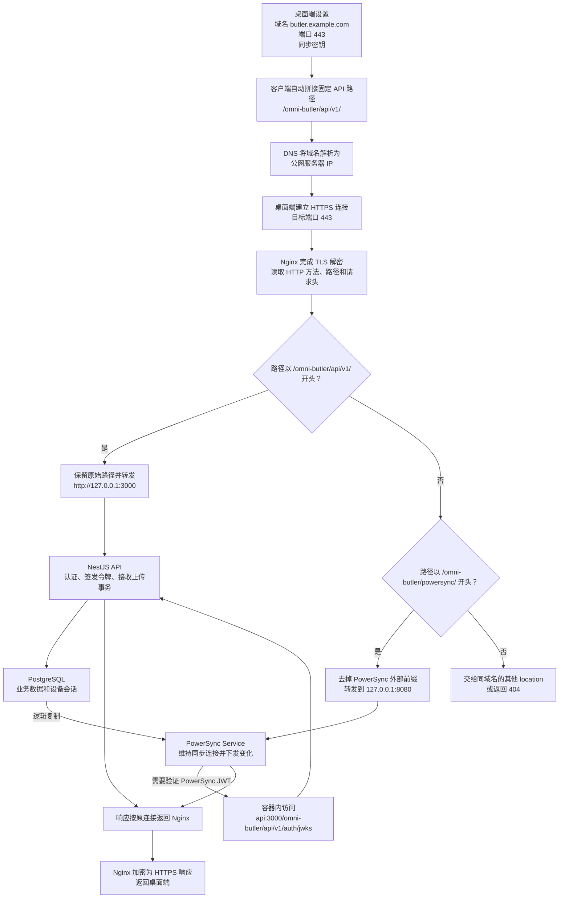

# Docker Compose 部署

在 `deploy/` 目录执行以下命令。Compose 会统一管理 PostgreSQL、API、PowerSync 和 MinIO 的网络、数据卷、启动顺序和健康检查。

## 准备

安装 Docker 和 Compose 插件（建议 v2.24.4 或更新版本；不要使用旧版 Python `docker-compose`）。首次部署将 `.env.example` 复制为 `.env`（PowerShell 使用 `Copy-Item .env.example .env`，CMD 使用 `copy .env.example .env`，Bash 使用 `cp .env.example .env`），已有 `.env` 时直接编辑，不要覆盖。

配置统一填写在 `.env` 中：

| 配置 | 用途 |
| --- | --- |
| `POSTGRES_PASSWORD` | 数据库密码，使用较长的随机字母数字串 |
| `SYNC_SECRET` | 客户端连接密钥，至少 16 个字符 |
| `API_HOST_PORT` | API 的宿主机映射端口，默认 `3000` |
| `POWERSYNC_HOST_PORT` | PowerSync 的宿主机映射端口，默认 `8080` |
| `PUBLIC_BASE_URL` | 同域名 HTTPS 公网根地址，例如 `https://butler.example.com`；后端自动推导同步与取音地址 |
| `IMAGE_SYNC_ENABLED` | 图片业务开关，默认 `false`；MinIO 始终运行，供笔记原音使用 |

Compose 自动读取当前目录的 `.env`，容器内部端口固定为 `3000`、`8080`。已有 `.env` 时补上 `API_HOST_PORT=3000`、`POWERSYNC_HOST_PORT=8080`，或填写自己的映射端口。

API 和 PowerSync 的公网路径固定为 `/omni-butler/api/v1/`、`/omni-butler/powersync/`，不需要也不能通过 `.env` 或客户端设置修改。

`PUBLIC_BASE_URL` 可带端口或末尾 `/`，但不能含账号密码、额外路径、查询参数或片段。独立覆盖属于高级选项：`POWERSYNC_PUBLIC_URL` 经 Compose 映射为后端 `POWERSYNC_URL`，`NOTE_ASR_PUBLIC_URL` 保留原名；非空覆盖优先，空值使用基础地址推导。非法非空配置会拒绝启动，不会回退到其他地址。

旧配置仍然有效。升级后若采用 `PUBLIC_BASE_URL`，应删除或注释旧的 `POWERSYNC_PUBLIC_URL` 和 `NOTE_ASR_PUBLIC_URL`，否则旧值继续优先。只设置基础地址不会启用腾讯识别，仍需单独配置识别厂商和凭证。

## 启动

配置完成后，Windows PowerShell、CMD 和 Linux / macOS 均使用同一条命令：

```text
docker compose up -d --build --wait
```

局域网直连时，注释或删除 `PUBLIC_BASE_URL`，允许 API 和 PowerSync 使用不同的 HTTP 端口。例如：

```dotenv
API_HOST_PORT=9000
POWERSYNC_HOST_PORT=9080
POWERSYNC_PUBLIC_URL=http://192.168.1.10:9080
```

客户端服务器地址填写 `192.168.1.10`，API 端口填写 `9000`。端口映射不会自动修改对外 URL；最终必须有一个 PowerSync 地址。未配置 ASR 公网地址时，小文件继续使用内联识别，超过 5MB 的文件会提示缺少公网地址。公网部署按下面的 Nginx 章节调整 `.env`。

如果之前在终端设置过同名端口变量，请清除它们或打开一个未设置这些变量的新终端；终端环境变量的优先级高于 `.env`。

## 笔记类别退休与Windows草稿升级

2026-10-12 起同步结构为4，笔记不再含类别。部署前备份PostgreSQL、MinIO原音/凭证卷以及客户端本机数据和草稿原音。先部署 `20261012000000_remove_note_categories`、对应API与 `powersync/sync-config.yaml`，确认迁移和同步可用后再升级Windows/Android客户端；不要删除数据库或PowerSync卷。迁移仅退休notes/category及其关联和note_entries的类别列，其他模块类别保持完整。

旧待上传请求保留原事务身份与原始负载摘要，服务端只在执行副本适配退休类别，避免响应丢失后的重试冲突；新版不得重新创建笔记类别。客户端SQLite19新增草稿本机表，本机备份格式4与服务器迁移协议3分离，草稿和原音不上传服务器迁移暂存；采用服务器数据换服时旧草稿留在旧数据源和备份。本轮只验证隔离数据库，不操作正式部署。

## 删除事件说明的升级

2026-10-11 起事件仅保留 `notes`（备注），删除 `events.description`（事件说明）及其旧内容。先更新服务端代码和 PowerSync 查询配置，在部署目录执行 `docker compose up -d --build --wait`，应用 `20261011000000_remove_event_description` 增量迁移；再升级所有客户端。本地 SQLite 会自动升级至 v16，保留备注、事件主体及完成历史。新客户端会过滤旧上传队列及旧迁移快照中的事件说明，避免访问已删除列。不要删除数据库或 Docker 卷。

## 可选图片同步

只需在 `.env` 中设置 `IMAGE_SYNC_ENABLED=true`，再执行上面的 `docker compose up -d --build --wait`。只接受小写 `true` 或 `false`，已有部署未填写该项时默认关闭。MinIO 使用固定版本的官方镜像，作为笔记与图片共用的常驻对象存储，不受图片开关影响。

MinIO 启动时自动生成随机内部凭证并保存在 `image-storage-credentials` 卷，API 按需初始化独立私有桶：图片为 `omni-butler-images`，笔记原音为 `omni-butler-note-audio`。两类对象都保存在现有 `image-storage-data` 卷。无需填写存储密钥、域名、端口、profile 或额外启动参数；客户端通过原有认证 API 上传下载，MinIO 不映射宿主机端口，浏览器管理界面关闭。

同步范围为物品和会员图片，首页背景仍只保存在各自设备。开启后客户端会补传本机已有图片，服务端已有的图片优先；新设备下载后的缓存离线仍可查看。图片传输失败可重试，不影响业务记录保存。服务器迁移只复制当前设备实际持有的图片，缺失文件会提示，不阻止业务数据迁移。

改回 `IMAGE_SYNC_ENABLED=false` 并执行相同启动命令，只停止图片传输；MinIO 和笔记音频继续可用，服务器对象、凭证及客户端本机图片都保留。再次改为 `true` 会复用原凭证和图片。首次从带 `image-credentials` 辅助容器的旧版本升级时，执行 `docker compose up -d --build --wait --remove-orphans` 删除已停用的旧容器；后续无需该参数。不要手动删除凭证卷，否则现有存储身份无法自动恢复。

本项目固定使用 MinIO 官方镜像 `minio/minio:RELEASE.2025-09-07T16-13-09Z`，并同时固定镜像摘要 `sha256:14cea493d9a34af32f524e538b8346cf79f3321eff8e708c1e2960462bd8936e`。它只面向容器内的 API，不额外公开 S3 端口或控制台。该版本存在未签名流式请求相关的已知风险；本项目的 API 只使用带签名的 S3 请求，当前使用场景接受该风险。

Docker Hub 当前已无法重新拉取 `minio/minio` 仓库。新服务器部署前，需要从已持有该官方镜像的可信机器导出并导入固定版本；不要改回 `latest`，也不要使用来源不明的同名镜像：

```text
docker tag minio/minio@sha256:14cea493d9a34af32f524e538b8346cf79f3321eff8e708c1e2960462bd8936e minio/minio:RELEASE.2025-09-07T16-13-09Z
docker save -o minio-RELEASE.2025-09-07T16-13-09Z.tar minio/minio:RELEASE.2025-09-07T16-13-09Z
docker load -i minio-RELEASE.2025-09-07T16-13-09Z.tar
```

## 公网部署：Nginx + HTTPS

使用一个域名访问 API 和 PowerSync，Nginx 直接安装在 Docker 所在的 Linux 宿主机上。

- 将 `butler.example.com` 替换为自己的域名，并解析到服务器公网 IP。
- 安装 Nginx，提前签发有效证书，准备完整证书链和私钥。
- 在服务器安全组和防火墙中允许访问 `80`、`443`。

在 `.env` 中确认或修改以下三项：

```dotenv
API_HOST_PORT=127.0.0.1:3000
POWERSYNC_HOST_PORT=127.0.0.1:8080
PUBLIC_BASE_URL=https://butler.example.com
```

端口配置支持 `监听地址:端口` 格式。上述配置将后端端口绑定到宿主机回环地址，公网请求统一经过 Nginx。保存后执行同一条 `docker compose up -d --build --wait`。

后端自动生成 `https://butler.example.com/omni-butler/powersync/` 和 `https://butler.example.com/omni-butler/api/v1`。如果确实需要不同域名，可独立覆盖：

```dotenv
POWERSYNC_PUBLIC_URL=https://sync.example.com/omni-butler/powersync/
NOTE_ASR_PUBLIC_URL=https://audio.example.com/omni-butler/api/v1
```

覆盖地址仍遵循各服务原有路径校验；ASR 地址必须为腾讯能访问的 HTTPS 地址。

### Nginx 配置

将以下内容保存到 `/etc/nginx/conf.d/omni-butler.conf`，确认该目录由 `nginx.conf` 的 `http` 块加载。替换域名和证书路径；示例证书路径不会自动生成证书。

API 和 PowerSync 分别固定使用 `/omni-butler/api/v1/`、`/omni-butler/powersync/`。两个前缀互不重叠，也不会占用当前域名的根路径，方便同一台 Nginx 继续部署其他服务。基础地址自动包含这些前缀；若独立覆盖 PowerSync 地址，必须保留固定路径和末尾 `/`。

```nginx
# 按请求决定是否升级为 WebSocket。
map $http_upgrade $omni_connection_upgrade {
    default upgrade;
    ''      close;
}

server {
    listen 80;
    server_name butler.example.com;

    return 308 https://butler.example.com$request_uri;
}

server {
    listen 443 ssl;
    server_name butler.example.com;

    # 替换为实际证书链和私钥文件。
    ssl_certificate     /etc/letsencrypt/live/butler.example.com/fullchain.pem;
    ssl_certificate_key /etc/letsencrypt/live/butler.example.com/privkey.pem;
    ssl_protocols TLSv1.2 TLSv1.3;

    # 与后端允许的上传大小一致。
    client_max_body_size 32m;

    proxy_http_version 1.1;
    proxy_set_header Host $host;
    proxy_set_header X-Real-IP $remote_addr;
    proxy_set_header X-Forwarded-For $proxy_add_x_forwarded_for;
    proxy_set_header X-Forwarded-Proto $scheme;
    proxy_set_header Upgrade $http_upgrade;
    proxy_set_header Connection $omni_connection_upgrade;

    # API：保留客户端已经拼接的完整接口路径。
    location ^~ /omni-butler/api/v1/ {
        proxy_pass http://127.0.0.1:3000;
    }

    # PowerSync 基础路径缺少末尾斜杠时，保留请求方法并补上斜杠。
    location = /omni-butler/powersync {
        return 308 /omni-butler/powersync/;
    }

    # PowerSync：去掉外部路径前缀后转发，并关闭响应缓冲。
    location ^~ /omni-butler/powersync/ {
        proxy_pass http://127.0.0.1:8080/;
        proxy_buffering off;
        proxy_cache off;
        proxy_read_timeout 3600s;
        proxy_send_timeout 3600s;
    }
}
```

API 的 `proxy_pass` 后没有 URI，因此完整 API 路径会原样交给 NestJS。PowerSync 的 `proxy_pass` 末尾必须保留 `/`，Nginx 才会把外部 `/omni-butler/powersync/` 替换成容器能够识别的根路径 `/`。未匹配这两个前缀的请求不会进入 Omni Butler，可继续由其他 `location` 处理；没有其他匹配时由 Nginx 返回默认响应。若修改了后端映射端口，也要修改对应的 `proxy_pass` 端口。Nginx 若运行在另一个容器里，`127.0.0.1` 指向 Nginx 容器自身，不能直接照用此配置。

### 桌面端如何访问公网服务

桌面端设置只填写以下三项，API 路径由应用自动拼接：

| 输入项 | 填写内容 |
| --- | --- |
| 服务器地址 | `butler.example.com` |
| 端口 | `443` |
| 同步密钥 | 与服务器 `.env` 中的 `SYNC_SECRET` 一致 |

公网域名默认使用 HTTPS，因此客户端会拼出 API 根地址 `https://butler.example.com:443/omni-butler/api/v1`；HTTPS 默认端口为 `443`，URL 中也可以省略。客户端不会直接访问公网的 `3000` 或 `8080`；这两个端口只允许同一台服务器上的 Nginx 访问。

| 网络入口 | 谁访问 | 作用 |
| --- | --- | --- |
| 公网 `443` | 桌面端 | 唯一的 HTTPS 业务入口，由 Nginx 监听 |
| 公网 `80` | 浏览器或误用 HTTP 的客户端 | Nginx 返回 `308`，要求改用 HTTPS；正常桌面端连接不需要先访问它 |
| `127.0.0.1:3000` | 服务器本机的 Nginx | Docker 映射到 API 容器的 `3000` |
| `127.0.0.1:8080` | 服务器本机的 Nginx | Docker 映射到 PowerSync 容器的 `8080` |



一次首次连接和后续同步大致经过以下步骤：

1. 客户端向 `POST https://butler.example.com/omni-butler/api/v1/auth/connect` 发送同步密钥。Nginx 匹配 API 专用 `location`，把原始路径转发到 `127.0.0.1:3000`。
2. API 校验密钥、在 PostgreSQL 中创建该设备的会话，返回短期访问令牌和设备凭证。
3. 客户端携带访问令牌请求 `POST /omni-butler/api/v1/auth/powersync-token`。API 返回 PowerSync 短期 JWT 和后端解析后的同步地址，本例由 `PUBLIC_BASE_URL` 推导为 `https://butler.example.com/omni-butler/powersync/`。
4. PowerSync SDK 在这个地址后追加 `sync/stream` 等协议路径。Nginx 匹配 `/omni-butler/powersync/`，去掉外部前缀，再把 `/sync/stream` 转发到 `127.0.0.1:8080`。
5. PowerSync 从 PostgreSQL 的逻辑复制流获得服务端变化并下发。桌面端的本地修改则由客户端整理成事务，再通过 `POST /omni-butler/api/v1/sync/operations` 上传给 API，最终写入 PostgreSQL。

同步密钥在连接预检、创建会话和显式迁移（含查询原迁移回执）时通过 HTTPS 请求体发送。普通业务 API 请求使用短期 Bearer Token；设备凭证只用于刷新令牌或断开会话。

Nginx 的分流依据是 URL 路径：`/omni-butler/api/v1/` 交给 API，`/omni-butler/powersync/` 交给 PowerSync，其他路径留给同域名上的其他服务。它不会解析请求 JSON 来选择服务。`Host`、`X-Real-IP`、`X-Forwarded-For`、`X-Forwarded-Proto` 等请求头也会一并传递。

首次连接请求的 HTTP 格式如下，JSON 中的密钥仅为示意：

```http
POST /omni-butler/api/v1/auth/connect HTTP/1.1
Host: butler.example.com
Content-Type: application/json

{
  "syncKey": "替换为服务器配置的同步密钥"
}
```

认证成功后的 API 请求使用 Bearer Token，例如获取 PowerSync 凭证：

```http
POST /omni-butler/api/v1/auth/powersync-token HTTP/1.1
Host: butler.example.com
Authorization: Bearer <accessToken>
Content-Length: 0
```

本地数据变更以一个完整事务上传，格式示例如下：

```http
POST /omni-butler/api/v1/sync/operations HTTP/1.1
Host: butler.example.com
Authorization: Bearer <accessToken>
Content-Type: application/json

{
  "clientId": "客户端数据库安装 UUID",
  "transactionId": "本地事务 ID",
  "operations": [
    {
      "op": "PATCH",
      "table": "todo_items",
      "id": "待办记录 UUID",
      "data": {
        "title": "修改后的标题"
      }
    }
  ]
}
```

这两个路径是服务协议的一部分，请保持 Nginx 配置不变。公网部署将示例域名和 `PUBLIC_BASE_URL` 替换为自己的域名；若使用独立 PowerSync 覆盖，确保地址以 `/omni-butler/powersync/` 结尾。

检查并加载配置（使用 systemd 的 Linux）：

```bash
sudo nginx -t && sudo systemctl reload nginx
```

验证两个服务的公网入口：

```bash
curl -f https://butler.example.com/omni-butler/api/v1/health
curl -f https://butler.example.com/omni-butler/powersync/probes/liveness
```

证书到期前需要续期并重新加载 Nginx。配置指令可查阅 [Nginx HTTPS](https://nginx.org/en/docs/http/configuring_https_servers.html)、[反向代理](https://nginx.org/en/docs/http/ngx_http_proxy_module.html)及 [WebSocket](https://nginx.org/en/docs/http/websocket.html) 官方文档。

## 客户端连接

在设置中开启“多端数据同步”：

| 输入项 | 局域网示例 | 上述 Nginx 公网示例 |
| --- | --- | --- |
| 服务器地址 | `192.168.1.10` | `butler.example.com` |
| 端口 | `3000` | `443` |
| 同步密钥 | `.env` 中的 `SYNC_SECRET` | `.env` 中的 `SYNC_SECRET` |

地址栏只填写 IP 或域名，端口单独填写。客户端会自动拼接固定 API 路径 `/omni-butler/api/v1/`；局域网 IP 默认 HTTP，公网地址默认 HTTPS，局域网也使用 HTTPS 时可填写 `https://192.168.1.10`。PowerSync 完整地址由后端下发，用户无需填写同步路径。

## 查看、停止与更新

查看状态和日志：

```text
docker compose ps
docker compose logs -f api powersync
```

停止实例，保留容器和数据：

```text
docker compose stop
```

重新启动、更新代码或修改 `.env` 后，执行 `docker compose up -d --build --wait`。Compose 会重新读取配置、构建镜像并按需重建容器，数据卷保留；更改已初始化数据库的密码还必须修改数据库内的角色密码，仅修改 `.env` 不会生效。

## 数据与备份

笔记正文和原音元数据要求客户端、服务器同步结构 v4 配套升级（类别退休，服务器迁移协议仍为3）。服务商密钥只配置在部署 `.env`：设置 `NOTE_ASR_PROVIDER=tencent`、`TENCENT_ASR_SECRET_ID`、`TENCENT_ASR_SECRET_KEY`；普通文本和本地录音不需要这些密钥。腾讯 API 3.0 不使用 APP_ID 参与签名。云端识别在用户授权后才提交。

长录音识别使用 `PUBLIC_BASE_URL=https://自己的域名` 推导的 API 地址，或高级覆盖 `NOTE_ASR_PUBLIC_URL=https://自己的域名/omni-butler/api/v1`，该 HTTPS 地址必须能被腾讯访问。服务器签发绑定任务的短期私有原音链接；腾讯本地文件方式上限为 5MB，超过该大小且未配置公网地址时会明确提示。Nginx 的 API `location` 需设置 `client_max_body_size 128m;` 和 `proxy_read_timeout 120s;`，允许完整原音与迁移暂存上传。

笔记新增原音及迁移暂存音频统一进入 MinIO 私有桶 `omni-butler-note-audio`，不再使用服务器音频目录或 `note-audio-data` 挂载。存储失败保留重试和清理回执，不回退写磁盘。客户端继续保留本机录音及缓存，支持离线使用。完整迁移先以部署同步密钥暂存原音，服务器迁移协议 v3 在同一事务验证并接管正式原音资产；只有用户明确确认缺失文件后才能使用省略清单。回收站保留 30 天，永久删除经持久文件清理队列执行。参见[原音接口与识别说明](../apps/server/src/notes/README.md)。

本次升级针对尚未部署笔记功能的服务器，无历史服务器原音迁移。若其他部署已使用磁盘原音，必须先制定并验证迁移方案，不能直接移除旧文件。

客户端更换服务器需先升级目标后端：在目标部署目录执行上面的 `docker compose up -d --build --wait`，启动会应用新增的迁移回执表，不会清空现有数据。PowerSync 至少需要 1.24.0 的检查点请求接口，仓库固定镜像为 1.25.0。再升级客户端，从「设置 → 数据同步 → 更换服务器」预检并选择数据来源。

选择以本机覆盖时，客户端发送经过确认的完整快照，后端一次事务替换目标业务数据及同步 owner；不需要删除 PowerSync 存储、复制槽或 Docker 卷。原目标设备会话失效，其他旧设备重新连接时应选择使用服务器数据。迁移发生故障时在同一客户端继续原迁移，不要通过删库、换密钥或重新建部署来处理暂时的网络超时。详见[客户端迁移与验证说明](../apps/client/README.md)。

`compose.migration-test.yml` 仅供开发隔离测试，使用固定公开测试凭证、回环端口 35430/35480/35439 和 `omni-migration-e2e` 项目名，不可作为正式部署配置。

业务库和同步状态保存在 `postgres-data` 卷，签名私钥保存在 `api-keys` 卷。实际卷名带 Compose 项目前缀；保持部署目录和项目名不变，不要使用 `docker compose down -v` 删除数据卷。

无论图片同步是否开启，完整备份都必须包含 PostgreSQL、`image-storage-data` 和 `image-storage-credentials`，并保留上面的 `api-keys`。停止 API/PowerSync 写入和 MinIO 后，将这些卷作为同一批备份保存；只备份 PostgreSQL 无法恢复原音或图片，只备份数据卷无法恢复存储凭证。恢复时使用同一批数据库、对象数据、凭证与签名私钥，再启动服务。凭证文件权限为 `0600`，只允许 API 用户和 MinIO 的 root 进程读取；不要把凭证内容放入日志或提交仓库。

`compose.notes-storage-test.yml` 仅用于 `omni-notes-storage-test` 隔离项目，公开测试配置为 `.env.notes-storage-test.example`。回环端口为 PostgreSQL 55449、MinIO 55490、API 55430、PowerSync 55480；正式配置没有 MinIO 端口映射。从仓库根目录仅启动测试存储：

```text
docker compose -p omni-notes-storage-test --env-file deploy/.env.notes-storage-test.example -f deploy/docker-compose.yml -f deploy/compose.notes-storage-test.yml up -d --wait postgres minio
```

`compose.image-test.yml` 为图片同步隔离测试覆盖配置，只能使用 `-p omni-image-test` 并同时传入 `-f docker-compose.yml -f compose.image-test.yml`；使用回环测试端口 35530/35580/35539，MinIO 仅在测试覆盖配置中映射 35590，调用方必须显式提供测试密码和同步密钥，禁止复用正式 `.env`。

从仓库根目录启动隔离环境（`.env.image-test.example` 仅含公开测试凭证）：

```text
docker compose -p omni-image-test --env-file deploy/.env.image-test.example -f deploy/docker-compose.yml -f deploy/compose.image-test.yml up -d --build --wait
```

单独备份业务库和私钥（Bash）：

```bash
docker compose exec -T postgres pg_dump -U omni_butler omni_butler > backup.sql
docker compose cp api:/app/keys ./api-keys-backup
```

API 文档：局域网为 `http://<服务器IP>:<API端口>/omni-butler/api/v1/docs`，上述公网部署为 `https://butler.example.com/omni-butler/api/v1/docs`。接口细节见 [服务端说明](../apps/server/README.md)。


## 2026-10-15 笔记图片与编辑格式升级（schema 5）

新增增量迁移 `20261015000000_note_images`、PowerSync 的 note_images 查询、图片类型 noteImage 与 capabilities.supportedBusinessTypes。Markdown 仍存在 note_entries.body，不迁移或重写历史正文。图片最终进入现有私有 MinIO，沿用图片业务开关 `IMAGE_SYNC_ENABLED=true`；关闭开关保留所有对象及元数据，本机图片保持待传。

升级顺序：先备份数据库和 MinIO 卷、停止客户端写入，再应用新增数据库迁移并更新 API，随后更新 PowerSync 查询，最后升级全部参与同步的客户端。不得清空 PostgreSQL／MinIO／PowerSync 数据卷。Android 本轮仅共享数据结构升级，无新增编辑界面。新旧 schema 不兼容时显示既有升级提示；没有 noteImage 能力的旧服务端不会收到必然失败的图片上传请求。

本机数据库升至20、快照升至5（可读取旧1–4），换服 wire snapshotVersion 保持3。正式图片子记录参与业务快照；本机图片原件、草稿及缓存纳入校验备份和候选源独立文件恢复。使用服务器数据时不混入旧本机草稿。正式部署尚未执行。


## 2026-10-19 笔记记录时间与置顶（schema 10）

先完整备份PostgreSQL、MinIO图片及原音、存储凭据和API密钥，再依次部署增量迁移 `20261019000000_note_record_time`、`20261019010000_note_pinning`、API及PowerSync下行配置，最后升级Windows与Android全部客户端。SQLite25、本机快照10（兼容1–9），换服wire3不变；旧客户端受schema10门禁限制，保留离线数据及原队列，不通过清库解决版本不兼容。

置顶字段 `note_entries.is_pinned` 为非空布尔且默认false；置顶PATCH不生成正文版本，旧正文PATCH缺失该字段时保留最新状态。下行必须包含置顶、记录秒数和偏移。升级后在独立环境验证两端置顶/取消、旧离线正文回放不重置置顶、备份恢复及记录时间往返，再推广真实客户端。本轮未执行正式备份、迁移、部署或真实联网验收。
