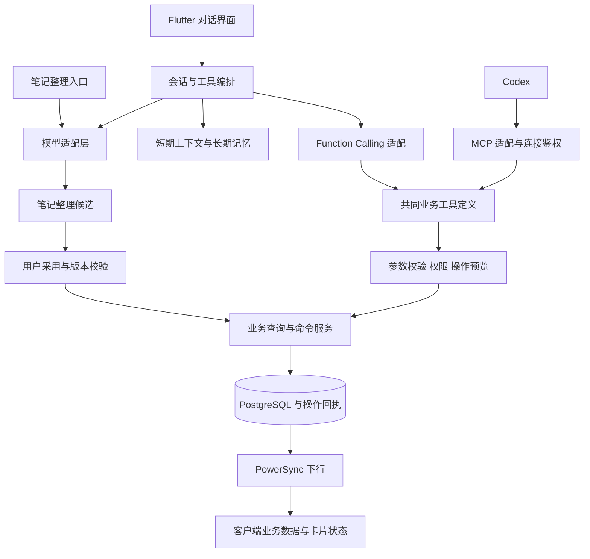

# 知序 AI 助手 PRD

版本：v0.2 评审稿

日期：2026-10-20

适用范围：Windows / Android 客户端、NestJS 后端、Codex MCP 接入

状态：整体产品方案，MCP 部分已完成代码实现与隔离验证，尚未部署及完成真实 Codex/双设备验收；应用内对话和长期记忆仍未实现。标为“建议默认”的选择用于形成可评审方案，不代表用户已确认。当前实现与接入说明见 [MCP README](../apps/server/src/mcp/README.md)。

本期已确认边界（2026-10-22）：Codex MCP 先行，覆盖七模块（含名言）读写及统计。有模块写权限即可调用业务工具，单条由后端自动完成预演与提交；同任务两个及以上独立业务目标通过 prepare_batch 固定预览，在 Codex 对话确认后 commit_action，无需知序端批准。MCP v3 完整权限下公开 65 个工具，权限以 get_capabilities 为准，名称及参数以 tools/list 为准。跨端基线保护继续生效；同步协议仍为 12，旧协议客户端必须升级。不承诺本机 SDK 测试等同真实 Codex 自然语言或双设备验收。以下应用内助手正文保留整体规划口径。

## 1. 产品定位与结论

为知序增加一个能够理解个人记录、执行明确指令、整理内容的 AI 助手。用户通过自然语言完成时间记录、物品、会员、事件、待办和笔记的管理，并基于真实数据生成周总结、月总结。

三个入口共用能力：

1. **笔记整理**：原音经现有语音识别得到转录文本，再由大模型整理成可编辑笔记。
2. **应用内助手**：聊天过程中查询数据、生成操作卡片、执行变更、展示结果并支持编辑和撤销。
3. **Codex 接入**：通过 MCP 使用同一套业务工具，直接管理数据、查询统计和生成总结。

**建议采用“统一业务工具层 + 应用内 Function Calling + 对外 MCP 适配”。** 模型接入、业务执行、界面呈现分别承担自己的职责；三个入口不各自实现一套增删改查。MCP 是工具连接协议，不负责长期记忆、业务事务或聊天界面。Function Calling 让模型提出工具调用，执行和结果校验仍由应用完成。[OpenAI Function Calling](https://developers.openai.com/api/docs/guides/function-calling)

首版采用单助手和有限工具循环，暂不引入多个自主 Agent、独立向量数据库或新的账号体系。优先验证“说得明白、改得准确、查得到结果、出错能恢复”。

## 2. 当前系统基础与范围边界

### 2.1 已有能力

| 现状 | 对 AI 的影响 |
|---|---|
| Flutter / Riverpod / Drift，本地 SQLite 优先，PowerSync 可选同步 | AI 的服务器结果与客户端本地数据之间存在同步时间差，不能假设所有设备实时在线 |
| NestJS / Prisma / PostgreSQL；主要结构化写入口为同步批量操作 | 尚不存在覆盖所有业务的独立后端领域 API；建设业务工具层是实际前置工作 |
| 单人自托管，一个内部 `SyncOwner`，设备会话认证 | 延续单人部署；新增 MCP 授权连接，不扩展为注册、组织、角色系统 |
| 笔记有原音、原始转写、不可变正文版本、草稿、标签及回收站 | AI 整理必须保留原文、人工修改和版本冲突处理 |
| 同步有事务回执、永久删除墓碑、派生状态协调 | AI 写入必须遵守相同规则，不能直接生成 SQL 修改业务表 |
| 业务规则分布在客户端 Repository、同步服务和数据库约束 | 不能把现有通用同步接口直接包装为允许模型自由填写表名和字段的工具 |

代码依据见第 15 节。部分历史架构文档早于笔记模块，当前能力以源码为准。

### 2.2 本次范围

覆盖模型服务接入、笔记整理、对话会话、短期上下文、可控长期记忆、业务工具、操作卡片、周月总结、MCP、审计与错误恢复。

“会员”指用户拥有的会员或订阅服务，例如视频会员、健身卡，不是客户会员管理。“事件”指洗牙、保养等周期事务，记录周期及完成历史；待办用于要做的任务，时间记录用于实际活动区间。三者不能在模型侧混为一类。

本需求扩展原有 AI 边界：笔记整理中提取的事项仍只生成建议，用户在对话助手中明确下达的操作指令则可按本文规则执行。

建议首版 AI 数据操作依赖已开启的同步和在线后端；未同步到服务器的数据不在可操作范围。本地离线功能继续可用，AI 页面说明“连接服务器后可使用”。离线大模型、仅本机数据代理不纳入首版。

### 2.3 暂不包含

- 真实支付、对第三方服务执行退订或续费、发邮件、控制其他应用。
- 任意 SQL、脚本执行、数据库管理、清空全部数据、通过 AI 永久删除业务记录。
- 持续后台监听、实时语音通话、自动浏览互联网、自动读取整台设备文件。
- 自动批量改写历史笔记、默认保存全部聊天内容为长期记忆。
- 首版自动定时周报/月报。首版支持手动请求，定时触发作为后续扩展。

## 3. 目标与核心使用场景

### 3.1 产品目标

| 目标 | 用户得到的结果 |
|---|---|
| 降低记录成本 | 一句话完成原本需要跨页面填写的记录 |
| 提高笔记可读性 | 保留原意，去掉口语重复，形成结构清楚的笔记 |
| 可控地执行变更 | 操作对象和影响可见，用户可以确认、修改、取消或撤销 |
| 建立连续理解 | 本轮能理解“刚才那条”，跨会话能记住经授权的偏好 |
| 让数据服务于复盘 | 总结中的数字可以核对，重要结论有来源 |
| 复用外部助手 | 在 Codex 中使用同样的业务能力，规则与应用内一致 |

### 3.2 场景示例

| 用户输入 | 预期行为 |
|---|---|
| “把这段录音整理成一篇笔记，保留我的原意。” | 对选定转写生成候选，允许查看原文、编辑及采用 |
| “补记今天 14 点到 15 点半看书。” | 解析具体日期和区间，检查重叠，展示时间记录操作卡片 |
| “开始记录写代码。” | 检查是否已有进行中记录，确认后开始；不自动结束另一条记录 |
| “加一件物品，索尼耳机，今天买的，1999 元。” | 生成物品草稿，只补业务规则允许的默认值 |
| “新增视频会员，30 元一个月，今天开通。” | 解析订阅周期；金额的账单含义、自动续费选项有歧义时补问 |
| “把这副耳机改成已卖出。” | 检索物品，重名时选择对象，展示旧状态和新状态 |
| “加一个洗牙事件，每六个月一次，上次是 9 月 1 日。” | 生成周期事件预览；补全或确认年份，不把它当成日历预约 |
| “明天下午三点开会，帮我记一下。” | 按待办及现有提醒能力生成预览，不误建周期事件；不声称已向第三方预约 |
| “我最近想学游泳。” | 正常对话，可建议添加待办；这句话本身不触发写入 |
| “把刚才那条改成明天。” | 同会话引用已确认的对象 ID，重新展示日期差异 |
| “删除上周误加的两个会员。” | 列出匹配项及关联影响，由用户选择并确认移入回收站 |
| “总结一下我上周的时间安排和笔记。” | 后端统计时间，检索笔记，输出带日期范围和来源的总结 |
| 在 Codex 中说“帮我查本月会员支出” | MCP 返回实际账单聚合，Codex组织答案；不要求后端再调用一次模型 |

## 4. 实现方案比较与建议

### 4.1 可选方案

| 方案 | 实现方式 | 优点 | 成本与边界 | 适用判断 |
|---|---|---|---|---|
| A. Function Calling 优先，增加 MCP 薄适配 | NestJS 建立共同业务命令与查询；应用内直接调用，外部通过 MCP 调用 | 最贴近现有栈；卡片与权限可控；两种入口复用执行逻辑 | 需维护两种协议映射和一致性验证 | **推荐** |
| B. MCP 优先，应用内也作为 MCP Client | 全部工具以 MCP 服务发布，内部编排器通过 MCP 访问 | 工具协议统一，适合未来接入多种外部服务 | 内部增加协议、连接与鉴权环节；仍需业务层、记忆和编排器 | 当多客户端复用是主要目标时可选 |
| C. 工作流或 Agent 框架承载编排 | 用现有框架管理工具循环、状态、检索和追踪，业务执行仍留在后端 | 多步骤流程较多时可减少编排代码 | 增加框架适配、部署和升级成本；无法替代数据规则 | 在复杂工作流确实出现后评估 |
| D. 第一阶段只做 MCP，先使用 Codex | 暂不建设应用内完整聊天；先发布工具及鉴权 | 可先验证自然语言操作和总结的价值 | 不能满足应用内聊天卡片；笔记整理仍需独立入口 | 适合希望最早在 Codex 用起来的交付顺序 |

以上是基于当前仓库规模的设计判断，不是框架性能排名。无论选哪种方案，业务授权、同步一致性和执行回执都必须在服务端落实。

### 4.2 推荐结构



共同工具层维护工具名、输入输出约束、权限、风险级别和执行方法。适配器转换为不同模型的 Function Schema 或 MCP Tool Schema。Schema 不能假设可原样复用：例如 OpenAI strict 模式有特定字段约束，需由适配器转换并由后端再次校验。[OpenAI Function Calling](https://developers.openai.com/api/docs/guides/function-calling)

建议继续使用 NestJS 模块化单体，按需增加模型适配、AI 编排、业务命令和 MCP 模块；不把原有 REST 与 PowerSync 替换成 MCP。

## 5. 功能需求一：转录文本整理为笔记

### 5.1 用户流程

1. 录音和语音识别沿用现有流程及授权。
2. 转写完成后展示“整理成笔记”；历史转写和当前正文可分别选择为整理来源。
3. 用户选择“轻度润色”“结构化整理”或“提炼摘要”，默认结构化整理。
4. 生成候选后展示原文与整理结果，可编辑、重试、放弃。
5. 点击“采用”时校验当前正文版本，成功后保存新版本；也可“另存为新笔记”。
6. 整理过程中用户修改正文或其他设备更新，结果仍保留为候选，不自动覆盖。

### 5.2 整理规则

- 轻度润色：修正标点、明显口语重复和断句，不改变语气、事实和立场。
- 结构化整理：按内容组织小标题与列表，保留数字、日期、人名和不确定语义。
- 提炼摘要：允许压缩细节，明确标识为摘要，不以摘要冒充完整转写。
- 无依据的人名纠错、待办截止时间、价格和事件完成状态不能自动补全；可标出“待确认”。
- 仅输出客户端支持的 Markdown 子集；标题沿用正文首个非空行派生，不新增独立标题字段。
- 遵守现有正文 20,000 字符限制；超限先选择分段、精简或另存多篇，不静默截断。
- 原音、首次原始转写、重新识别结果、整理候选和正式正文分别保留。
- 文本中提及的待办或事件仅能形成建议卡片，整理任务本身不自动执行这些业务操作。

### 5.3 自动整理选项

建议默认“手动整理并预览”。用户可选择“新录音转写后自动生成整理候选”，首次启用说明文本会发送到所选模型服务商，语音识别同意不自动等于大模型整理同意。

自动生成候选不等于自动采用。后续可增加“自动采用新录音整理结果”，仅在用户明确开启、来源完整、正文基线未变且发起设备不存在未保存草稿时执行；服务端无法判断所有离线设备的草稿状态，不承诺全设备无冲突。

现有客户端在符合授权及基线条件时会自动插入原始转写。接入整理链路必须增加互斥状态：录音开始前，或转写完成且尚未插入前，选择“原文插入”或“整理后采用”，不能两条链路同时追加而产生重复正文。整理失败时提供“使用原文”，不丢录音或重复提交语音识别。

若用户在原文已插入后点击整理，或整理历史转写，必须绑定当时的正文版本和明确替换范围；采用时展示替换预览，不能再次追加同一段文字。无法可靠定位原文范围或对应内容已被人工修改时，由用户选择替换范围、人工采用或另存；不凭字符串相似性自动替换。

### 5.4 失败与恢复

任务状态包含等待、生成中、候选就绪、失败、已取消、提交结果待核实。任务身份绑定来源片段/文本摘要、整理方式和输入版本；查看同一任务不重复计费。

模型超时不影响已保存的原始资料。服务商若不能确定请求是否完成，先查询已有请求状态；不盲目重发可能计费的生成。用户主动“重新整理”是新任务，与恢复已有任务区分。候选保存不等于正文写入成功，采用失败保留候选。

## 6. 功能需求二：应用内对话助手

### 6.1 界面与入口

- Windows 在现有导航增加“AI 助手”页面；Android 首版通过首页入口进入独立聊天页，不重构现有底部导航。
- 支持新建、切换、重命名、删除会话，查看历史消息和操作结果。
- 输入区首版支持文字；语音转文字作为后续能力复用现有采集流程。
- 消息支持流式文本、引用、对象卡片、操作预览、执行结果和错误状态。
- 明确显示“正在理解”“查询中”“等待确认”“执行中”“已完成”；不展示模型内部推理过程。
- 提供停止生成；停止不撤销已提交的业务操作，已完成操作保留结果卡片。
- AI 服务未配置、额度不足、后端离线时给出可操作提示，不影响普通业务页面。

### 6.2 理解与澄清

写入前必须识别业务模块、目标对象、动作和必要参数。没有得到的必填信息只问必要部分；已有表单合法默认值可使用，但在预览中展示。

“新增”“帮我记一下”“改成”“删除”等明确指令可产生操作；感受、设想、假设句及引用内容不能独立触发写入。“我以后可能取消这个会员”只参与聊天。

同名对象返回候选列表，显示名称、日期、类别等区分信息。模型不能取第一条匹配当作用户选择。查不到目标时说明未找到，不把更新改为新增。

“刚才那条”“它”仅在会话中存在唯一明确引用时解析；换会话不隐式复用另一个会话的待执行操作。

### 6.3 操作策略

本节为尚未实现的应用内助手规划；Codex MCP 使用已确认的 10.3 节直接写入与批量对话确认规则。

建议提供两档设置，首版默认“确认后执行”；“快捷执行”在撤销和幂等机制验收后开放。

| 操作 | 确认后执行模式 | 快捷执行模式 |
|---|---|---|
| 查询、统计、生成总结草稿 | 直接执行 | 直接执行 |
| 明确的单条新增，字段完整且无冲突 | 预览后确认 | 可直接执行并展示结果与撤销 |
| 单条普通字段或可逆状态更新 | 展示前后差异后确认 | 对已明确目标且列入白名单的动作直接执行 |
| 随口提及、目标歧义、参数缺失 | 澄清或建议，不执行 | 同左 |
| 软删除、批量修改、关联级联、会员金额/账期/自动续费变更 | 必须确认影响范围 | 必须确认影响范围 |
| 永久删除、清空全库、数据库管理 | 不开放工具 | 不开放工具 |

判定由服务端规则完成，不能只凭模型返回的“高置信度”跳过确认。长期记忆中的“以后别问我”不能改变这张权限表。

### 6.4 卡片设计

**操作预览卡片**：业务类型、名称、动作、关键字段、变更前后差异、关联影响和解析后的完整日期。按钮为“确认”“编辑”“取消”；编辑后旧预览失效，生成新预览并重新确认。

**结果卡片**：已完成的动作、真实记录、关键字段、服务器提交时间、客户端同步状态。按钮为“查看”“编辑”“撤销”；无可靠补偿方案的动作不展示撤销。

**选择卡片**：列出重名候选或批量操作对象，用户选择后才准备变更。

**失败/冲突卡片**：说明哪些未执行、哪些已执行，提供刷新对象、修正参数、核实结果等操作。不能用“再试一次”重新创建同一条记录。

示例：

```text
待确认 · 补记时间
阅读
2026-10-19 14:00—15:30（Asia/Shanghai）
时长 1 小时 30 分钟 · 无时间冲突
[确认]  [编辑]  [取消]

已添加 · 阅读
服务器已保存 · 正在同步到本机
[查看]  [编辑]  [撤销]
```

卡片由服务端结构化结果驱动，Flutter 使用原生组件渲染，不执行模型生成的 HTML 或按钮代码。已完成卡片保留当时的操作事实，打开详情时读取当前对象；对象后续被修改或删除时显示状态差异。

### 6.5 执行、取消与撤销

```text
理解请求 → 补全信息 → 生成预览 → 等待确认 → 执行 → 成功 / 失败 / 冲突
                         │                  │
                         └→ 取消或过期       └→ 结果待核实 → 按原操作 ID 查询
快捷执行：满足规则时跳过等待确认，但仍经过校验、预览数据生成及持久回执。
```

- 取消只保证尚未执行的操作不再开始。执行中的取消为尽力停止，最终以持久回执为准。
- 撤销是新的一次补偿操作。新增通常通过软删除撤销；修改恢复本次改变的字段；软删除通过现有恢复规则撤销。
- 撤销前检查对象及关联记录是否仍满足原操作的后置状态。别人或另一设备已修改时，提示冲突，不覆盖后续变化。
- 首版建议一般 AI 操作补偿窗口 10 分钟，且只能撤销标记为可补偿的动作。事件页面既有“记录现在”的快捷撤销仍为 6 秒；AI 对事件完成记录超过 6 秒后的补偿按历史撤回处理，需重新展示影响并确认，不借通用撤销绕过确认。回收站恢复继续遵守现有产品规则。
- 重复点击确认、重复交付消息、网络重试仅返回原回执。用户再次明确要求创建另一条时才分配新操作身份。
- 多动作一句话先拆成可见清单。明确要求“一起完成”的、全部位于本数据库的写入应同事务全成功或全失败；独立执行的动作逐项反馈，不能把部分成功写成全部成功。

## 7. 业务能力与领域规则

所有工具仅操作当前认证归属的有效业务数据。默认查询排除回收站；查询回收站和恢复必须显式指定。

| 模块 | 首版能力 | 必须遵守的规则 |
|---|---|---|
| 时间记录 | 查询、开始、结束、补记、修改已完成记录、软删除、恢复 | 通常仅一条进行中记录；结束须有活动内容且晚于开始；冲突时不得自动截断或删除。保留现有逐条结束同步造成的多条进行中记录的修复路径 |
| 物品 | 查询、新增、编辑、合法状态变更、软删除、恢复 | 状态为在用/闲置/借出/售出/丢弃；数量大于零、金额不为负；删除父物品涉及配件，恢复仅恢复同批删除项；分类/位置使用规范关联 ID |
| 会员 | 查询、新增、编辑、试用/使用/已取消状态更新、记录续费、软删除、恢复 | 基础状态与推导的到期状态区分；周期与永久会员日期约束不同；支付历史与账期一致；“取消自动续费”仅更新本系统记录 |
| 事件 | 查询、新增周期事务、编辑、登记/撤销完成、归档、软删除、恢复 | 完成历史及最后完成时间一致；状态按周期推导；不当作日历预约，不新增已移除的 description 字段 |
| 待办 | 查询、新增、编辑、完成/重开、软删除、恢复 | 普通父子级联和进度任务规则一致；满进度不自动完成根任务；重复系列需选择仅本次或本次及以后，进度任务不支持子任务/重复或创建后转换类型 |
| 笔记 | 查询、检索、创建、整理候选、修改正文、软删除、恢复 | 不覆盖并发人工版本；遵守标签与版本规则；未发布本机草稿不供服务器工具读取 |

复杂关联能力可晚于单条 CRUD 交付，尤其是重复系列修改、支付历史删除引起的账期回退和批量级联。未完成对应规则的动作必须在工具清单中标记未开放，不让模型以底层字段写入绕过限制。

### 7.1 日期与金额

会话携带请求时刻、用户配置时区和周起始日。建议默认使用用户当前时区、周一为一周起点；时区未知时不从模糊设备名称猜测 IANA 地区。

“今天、明天、上周”在准备操作时解析为绝对范围，并在卡片展示。“下午三点”按业务字段支持的精度处理；跨午夜、跨时区和缺少年份的日期存在歧义时澄清。确认跨越了时间敏感边界时重新校验，不能在执行时悄悄重新解释“明天”。

首版沿用现有人民币 CNY、整数分存储，输入金额按确定的十进制规则转换，禁止浮点误差。用户输入其他币种时说明当前不支持，不直接当人民币保存；不新增币种字段或自动换汇能力。

## 8. 记忆与上下文管理

### 8.1 区分四类信息

| 信息 | 保存内容 | 使用规则 |
|---|---|---|
| 会话历史 | 用户/助手消息、工具调用和操作引用 | 用于展示与恢复会话，不代表每轮全部发给模型 |
| 短期上下文 | 近期对话、滚动摘要、当前任务、对象引用、待确认操作 | 当前会话使用；待确认操作必须以数据库状态为准 |
| 长期记忆 | 经授权的表达偏好、稳定目标、常用称呼或分类映射 | 可查看、编辑、停用、删除；检索少量相关项 |
| 业务事实 | 笔记、物品状态、会员日期、时间记录和统计 | 从业务工具获取最新事实，不能依赖聊天记忆推断 |

“我喜欢周报简短一点”适合记忆；“这个会员还剩 10 天”是随时间变化的事实，必须重新查询。

### 8.2 短期上下文策略

每轮按“服务规则 → 当前请求与任务 → 相关记忆 → 历史摘要与近期消息 → 工具结果”组织输入，按模型实际上下文上限预算，并预留回答和工具调用空间。

建议在预算使用超过 70% 时压缩已完成历史，优先移除过期的大体积工具结果；当前用户要求、未解决的问题、对象 ID、权限范围和待确认动作不能仅靠有损摘要保存。

检索和工具响应分页、限量，提供总数、筛选条件及是否截断。工具调用与结果成对保留。会话摘要记录覆盖消息范围，允许重新生成；重启应用后从持久会话与操作状态恢复，不依赖内存中的 Agent 对象。

### 8.3 长期记忆策略

建议首版只保存用户明确说“记住……”的内容，或用户点击记忆建议卡片确认的内容。默认不开启后台自动抽取。

每条记忆包含内容、类别、来源会话、创建/更新时间、有效期和状态。临时偏好可设到期，稳定偏好长期有效；相互冲突的偏好要求更新旧项，不能无期限累积矛盾记录。

设置页提供“记忆管理”：查看、编辑、删除单条、清空、暂停写入、暂停使用。删除会话时说明是否同时删除从该会话形成的记忆；删除记忆后，后续上下文、摘要缓存和检索索引不得继续注入该内容。

当用户要求彻底忘记某事实时，还要处理其来源消息或相关摘要；仅删一条记忆但继续把同一事实从历史检索回来，不算完成遗忘。已交给外部模型服务商的数据按其数据处理政策管理，不承诺由本系统删除其所有副本。

首版使用 PostgreSQL 保存记忆和结构化筛选，按业务数据量验证关键词检索效果；出现明确语义检索缺口后再评估向量检索。权限、owner 归属和删除过滤必须先于检索结果返回，向量结果不能绕过它们。

### 8.4 Codex 与应用内记忆边界

Codex 自身聊天上下文不会自动同步到知序；知序聊天历史也不默认全部提供给 Codex。业务数据由共同工具访问，知序长期记忆仅在连接授权包含相应范围时通过专用工具读取或建议更新。MCP 会话标识不等同于业务用户身份或长期记忆。

## 9. 总结与分析

### 9.1 周总结、月总结与专题查询

用户可指定自然周、自然月、自定义范围和模块。首次缺省采用当前自然周/月的已发生部分；“上周”采用完整上一自然周，“最近七天”作为另一种范围，不能混算。

建议输出结构：时间范围与数据覆盖、核心数字、完成的事情、笔记主题、异常或变化、可选的下阶段建议。用户可以继续要求“只看工作”“缩短一些”“和上个月对比”。

### 9.2 统计口径

- 时间总量与分类占比由后端计算；跨日记录按与查询区间的交集切分。进行中记录单列暂估时长，不与已结束记录混淆。
- 会员实际支出按支付历史和支付日期计算；计划续费、预计支出单列，不能把当前会员价格相加当作已支付金额。
- 物品新增支出与会员支出分别展示；无金额或疑似重复账目在覆盖说明中体现，不由模型自行删账去重。
- 事件完成次数读取完成历史，待办完成按完成时间筛选；不因现在状态为完成就把它算到任意历史月份。
- 周月笔记范围默认按 `dayKey`，时间/交易范围按对应事实时间；写清归档时间与创建时间的差别。
- 数字由工具结果提供，模型负责组织与解释。比例、同比环比仍由后端计算，基期为零或数据不足时不生成误导百分比。

### 9.3 可信度与保存

总结包含数据截止时刻、时区、筛选范围和主要结论的来源引用，点击可打开相关记录或明细。检索只覆盖部分笔记时明确覆盖范围；没有记录只说明没有记录，不能得出“你什么也没做”。

“本周阅读时间下降”属于可核对事实；“可能因为工作更忙”属于推测，应标为推测，不能臆测情绪、健康或因果。

生成总结默认只产生聊天结果。点击“保存为笔记”或明确发出保存指令才创建笔记，记录统计区间、生成时间和来源引用。重新生成不得自动覆盖已保存的人工修改。

MCP 建议提供统计与证据包工具，由 Codex 生成文字总结；仅当用户明确要求调用知序特定整理/总结模型时才另行触发后端模型调用。

## 10. MCP 接入要求

### 10.1 连接方式

建议在现有后端新增 Streamable HTTP MCP 端点，路径由部署配置确定。Codex 当前官方文档支持 STDIO 和 Streamable HTTP，并支持 HTTP Bearer token 或 OAuth；个人自托管首版可采用受限的专用连接令牌。[Codex MCP 接入文档](https://learn.chatgpt.com/docs/extend/mcp?surface=cli)

专用令牌只保存摘要、设置有效期、绑定当前 owner 和权限范围，可在设置页撤销。不得直接复用部署同步密钥，也不把某个设备的长期凭据复制给 Codex。只读令牌为默认，用户按需要开启对应模块的写权限。

后续需要标准 OAuth 授权及更多客户端兼容时再增加 OAuth 2.1；其授权发现、resource/audience 校验和令牌处理应遵循 MCP 授权规范。专用令牌模式不宣称已实现完整 OAuth 授权流程。[MCP Authorization](https://modelcontextprotocol.io/specification/2025-06-18/basic/authorization)

### 10.2 工具组织

当前 MCP v3 使用业务名称与少量统一入口，完整权限下共 65 个公开工具；内部领域兼容方法不等同于公开工具：

| 类别 | 工具示例 | 行为 |
|---|---|---|
| 能力与范围 | `get_capabilities` | 返回当前连接权限、时区、服务器时间、版本及限制，详见 10.4 |
| 查询 | `search_notes`、`list_time_entries`、`get_membership` | 明确过滤、分页与来源 |
| 统计 | `get_statistics(module, …)`、`get_review_context` | 统一七模块统计，保留物品全量/窗口及配件口径，返回确定性数字和必要证据 |
| 单条写入 | `create_time_entry`、`update_item`、`create_note` | 后端自动预演与提交，返回实际执行回执 |
| 回收站 | `list_recycle_bin(module, …)`、`restore_record(module, id, …)` | 统一查询与单条恢复，保留领域关联规则与权限 |
| 批量准备 | `prepare_batch` | 固定业务步骤和基线，形成预览，无业务表变更 |
| 执行与恢复 | `commit_action`、`cancel_action`、`get_action_status`、`undo_action` | 校验授权与版本后执行、核实或补偿 |
| 长期记忆（未实现） | 尚无公开工具 | 后续需要独立授权范围，遵循应用内记忆确认规划 |

模型不选择任意数据库表、SQL、owner ID 或自由列名。工具以业务动作暴露，避免通用 `execute_sql` 或任意 `update_record`。一次仅向模型暴露当前任务及授权需要的工具。

公开参数表达用户意图和必要可靠性约束：

- 时间列表支持 `status=ongoing/finished/all` 和可选成对范围，移除无作用的 `timeZone/asOf`；进行中查询不必设窗口。
- `get_statistics` 的 `asOf` 只适用于时间、待办、会员和事件。日签、笔记、物品不接受无效历史截止点；自然日统计保留时区，库存全量统计可不传范围。
- 分类、位置和标签只使用查询得到的规范 ID。新增时间、物品、会员、笔记未指定分类或标签时，从已有项选择最合适的一项，没有合适项留空；明确留空、已有指定及编辑操作不自动重分类。
- 笔记记录时间使用单个带偏移 `recordedAt`，新增省略取当前时刻，编辑省略保留。后端转换内部存储字段，模型不填写拆分时间组。
- 笔记编辑和进度步骤替换使用 `get_note/get_todo` 返回的 `editToken` 原样回传，保留正文候选、标签合并和结构基线；不能自造或自动刷新覆盖冲突。
- 编辑令牌有效 24 小时，绑定归属、连接和对象，持久签名密钥支持跨进程重启验证，密钥轮换后旧令牌失效。步骤令牌只保存有序结构摘要，准备时在 owner 锁内验证后才提供领域基线，完成状态不影响结构编辑。
- 会员永久属性统一为 `billingCycle="permanent"`，基础编辑不接收时区；待办类型只在创建时选择。稳定 `requestId` 继续用于重试去重，不让删减参数破坏可靠性。

重复待办由后端启动及每 30 秒调度按持久断点补齐到今天，查询不承担生成副作用，也不要求模型调用生成工具。时区采用当前 owner 有效待办读写连接的显式设置；规范化后无唯一时区、无有效授权时暂停并记录原因，条件恢复后继续。每轮最多 10 个 owner、每个 4 个系列、每系列 7 天；不生成未来实例。

断点包含锚点、时区和规则变化签名，排程改变会重新检查，普通生成实例不重置进度。每个系列单独保存点，失败只撤回本系列本轮变更并退避 60 秒，其他系列可继续提交；失败期间不能宣称已追平。实例、断点及持久保护身份同事务保存，后台根项和子项同样拒绝旧离线 PATCH/DELETE 覆盖；撤销连接保留既有保护，删除 owner 才清理。

客户端与后端统一按规则段起始日计算周期，连续同规则实例不改变锚点，频率变更重新起算；单次 null 例外不停止系列，从当前及未来关闭主系列必须写 stopped，普通编辑保留终止事实。停止系列、永久墓碑及客户端稳定身份仍有效。本轮需要更新 Windows/Android 逻辑，保持同步 schema 12、SQLite 26、快照 11 和 wire snapshot 3。

### 10.3 MCP 中的确认与结果

当前已确认：连接的模块写权限就是后端执行授权，Codex 可直接操作该模块数据，无需到知序设置批准。默认只读、有效期、撤销及权限边界继续生效。

- 单条任务目标明确、字段完整时，直接调用业务写工具，后端自动完成预演和提交，Codex 展示真实结果。
- 同一用户任务涉及两个及以上独立业务对象时，先通过 `prepare_batch` 固定预览，再展示目标、数量、变更与关联影响，等待用户在当前对话明确确认后 `commit_action`。单个对象正常产生的账单、正文版本或子项不另计；不得拆成多次单条调用绕过批量确认。
- 确认后目标或内容变化须重新确认，数据冲突时停止，不自动刷新基线覆盖。用户取消时调用 `cancel_action`，仅取消尚未执行动作，不回滚已提交数据。
- 每批最多8步、200条实际变化；超步骤上限先展示完整目标与分批方案，确认后逐批准备执行，跨批不保证原子性，失败停止并报告已完成范围。
- 批量确认是 Codex 的对话规则，服务端不验证聊天中的人工确认，不把 `confirmed: true`、工具注解或预览身份当成人工授权证明。
- 保留真实预演、固定参数、owner锁、基线、幂等回执、正文候选与跨端保护；结果未知时核实原动作。`undo_action` 补偿仅限原成功时间起10分钟内，且准备及提交均校验后置基线。
- 单条响应不确定时复用原 `requestId` 和原参数重试；已有 `actionId` 时查询状态，不生成新身份重复新增。先重放原动作再校验编辑令牌，因此令牌过期不影响原请求重放，连接授权、动作有效期和终态仍校验。总结默认不保存，用户明确要求保存单篇时调用 `create_note`。
- 设置页仅显示操作记录和完整详情。旧设备审批端点返回410，升级迁移取消旧未执行 pending/approved，保留历史成功回执与原连接权限。发布须先停止旧API请求，再迁移和启动新版；Codex重连刷新规则。
- v3 发布包含第 26 份后台调度迁移和第 27 份后台保护迁移，全部 27 份迁移应用后再启动新版 API。私有调度及保护表不进入 PowerSync 或业务快照；保护身份随数据库备份，不作为日志清理。随后更新客户端，不能因为存储版本未变而省略升级。

MCP 返回结构化内容与文本说明，包含操作状态、对象引用、影响范围和错误。MCP 支持结构化工具结果，但协议不规定特定卡片界面；首版不承诺 Codex 展示与 Flutter 完全相同的可编辑卡片。[MCP Tools](https://modelcontextprotocol.io/specification/2025-06-18/server/tools)

### 10.4 能力发现与功能说明

用户接入后，可以直接询问“知序 MCP 有哪些功能？”或“我当前能查询和修改哪些数据？”。Codex 应依据实际工具定义及当前连接的能力结果回答，不依赖读取本仓库、PRD 或用户手动提供工具清单，也不能把规划功能介绍为已开放能力。

能力发现由以下三部分配合完成：

| 机制 | 职责与要求 |
|---|---|
| MCP 工具列表 `tools/list` | 提供实际注册且允许当前连接发现的工具名称、描述和参数约束。工具可以按需加载，不能假设模型在每轮上下文中始终持有完整清单 |
| 初始化 `instructions` | 简要说明知序用途、跨工具规则、数据边界，以及遇到功能或权限询问时使用 `get_capabilities`；不在这里重复维护整份工具目录 |
| 业务工具 `get_capabilities` | 面向自然语言问答，返回服务端按当前连接授权计算的能力说明；这是知序自定义工具，不是 MCP 协议内置接口 |

Codex 支持读取初始化返回的服务端 `instructions`。每个工具的名称和描述应准确说明用途、适用情形、限制及副作用；不能只给内部方法名或“操作数据”等模糊描述。[Codex MCP 接入文档](https://learn.chatgpt.com/docs/extend/mcp?surface=cli)、[工具描述规范](https://developers.openai.com/plugins/plugin-guidelines)

`get_capabilities` 是经过连接认证的只读工具，不修改业务数据，不调用后端大模型，不扫描或返回用户笔记正文。返回结构化内容及简短中文说明，至少包括：

| 信息 | 内容要求 |
|---|---|
| 服务与版本 | 服务名称、能力定义版本；便于识别服务升级后的目录变化 |
| 开放模块与操作 | 返回七模块实际读写范围；具体业务工具及参数读取 tools/list，不再重复返回完整目录 |
| 当前连接权限 | 区分可用、未授权和暂未开放；只读连接不能显示为具有写入权限。未开放项如需说明，应单独标为不可用，不混入可调用工具列表 |
| 执行与确认条件 | 明确连接写权限、单条直接执行及批量对话确认规则；业务方法存在不等于已注册或已获模块授权 |
| 时间与数据范围 | 服务端当前时间、时间计算采用的时区与来源、仅覆盖服务器已接收数据的说明；未配置默认时区时明确需要用户提供，不能猜测设备时区 |
| 查询与调用限制 | 实际分页上限、日期范围、材料截断等约束；统计覆盖范围与返回明细范围分别说明 |
| 重复待办状态 | 有待办读权限时返回 todoRecurrence 的 status/timeZone/reason/checkedAt；无记录为 not_checked，其余状态为 idle/catching_up/blocked_authorization/blocked_timezone/error。它是最近检查结果，查询不触发生成，也不暴露内部断点或连接身份 |

工具注册依据同一份元数据并结合实际授权筛选；能力结果只提供连接上下文、权限与限制，不重复维护工具目录和示例。新增、下线或调整工具时，其描述、参数约束和权限必须同步变化。后端已有业务方法只在完成 MCP 映射、授权及必要确认机制后才成为公开能力；不能通过通用执行器绕过逐项工具暴露。Codex 可依据实际目录组织功能示例，不能暗示未授予的写权限。

服务端只能确认自身开放的工具和权限；Codex 本地还可能通过 `enabled_tools`、`disabled_tools` 或其他宿主策略进一步限制工具。最终可调用范围是服务端授权与宿主实际开放范围的交集，不能由服务端能力结果断言某个工具一定在 Codex 中可调用。能力说明也不授予权限，每次实际调用仍须按 10.1、10.3 校验授权及确认条件。[Codex 工具访问配置](https://learn.chatgpt.com/docs/extend/mcp?surface=cli)

用户询问功能时，推荐按“查询当前连接能力 → 结合宿主实际可发现工具 → 按模块解释功能、权限、确认条件和示例”的流程回答。只询问功能不触发实际新增、修改、删除或审批。连接失败、令牌过期或能力查询失败时，应明确当前能力无法核实，不能拿 PRD、旧会话印象或历史缓存冒充当前授权结果；重新授权或重连后重新查询。

验收询问示例：“请调用知序 MCP 的 `get_capabilities`，按模块列出当前连接可用的功能、写入权限和确认要求，每类给一个自然语言示例。不要执行数据变更。”

## 11. 后端执行与数据一致性要求

### 11.1 共同业务命令层

按模块逐步建立查询与命令服务，将 AI 必需的业务规则在服务端落实，并复用现有同步校验、派生状态协调和数据库约束。先覆盖本期工具范围，不进行全仓库重构。

新服务需要处理参数、认证归属、目标状态、关联记录、可逆性和最终返回值。保留现有客户端同步入口，但与 AI 入口共享关键规则，防止两套实现逐步分叉。

工具调用建议结果包括 `actionId`、`status`、`entityRefs`、`before/after`、`effects`、`errorCode` 和 `retryable`，字段以技术设计为准。界面成功状态来自事务回执，不来自模型自然语言。

### 11.2 幂等、并发与同步

- 同一请求身份与负载摘要绑定，身份相同但负载不同拒绝执行。业务变更与操作回执在同一事务保存。
- 生成内容可重试与业务操作可重试分开处理。模型换一家、重新生成回答、刷新聊天均不重做已成功写入。
- 预览记录对象基线，提交在事务内重读并检查；对象已修改、软删除、永久删除或 owner 已变化时拒绝旧预览。
- **仅在 AI 入口检查版本还不够。** 离线客户端随后上传旧修改也可能覆盖 AI 结果。首版写操作验收必须包含客户端上传的字段基线/修订校验与冲突保留，具体按模块设计；需要改变同步契约时同步升级客户端、服务端和版本门禁。
- 笔记复用现有 `base_revision` 和不可变版本；其他模块不能假设已具备同等冲突保护。暂未完成并发保护的模块只能开放读取或缩小写工具范围。
- 服务端写入后通过 PowerSync 下发；结果卡片可先显示“服务器已保存、待同步”，不能为了刷新页面在客户端再次创建记录。
- 应用内操作前等待本机相关待上传事务完成并建立查询检查点；无法完成时提示服务器视图可能落后，阻止依赖最新状态的写入。其他离线设备的数据仍无法保证已齐全。
- Codex 只能读取服务器当前已接收数据，统计标注截止时刻，不宣称覆盖未同步设备。
- 换服、恢复备份或重建 owner 时，旧会话操作卡片、MCP 令牌、待确认操作失效；不能把旧授权迁移成新库的写权限。

### 11.3 持久数据建议

| 新数据概念 | 目的 | 建议保存位置 |
|---|---|---|
| AI 会话与消息 | 多端历史、恢复与删除 | 后端 PostgreSQL，客户端缓存 |
| AI 运行与事件 | 流式断线续接、停止、模型用量与失败恢复 | 后端；事件带稳定序号 |
| 操作预览、审批与回执 | 确认、幂等、审计、撤销 | 后端，与业务事务关联 |
| 长期记忆 | 用户控制的跨会话偏好 | 后端，单独管理权限与删除 |
| 整理候选 | 来源、输入版本、输出、采用状态 | 后端持久保存，客户端查看/编辑 |
| MCP 授权连接 | 令牌摘要、范围、有效期与撤销状态 | 后端私有表 |

建议 AI 会话首版经专用 API 同步，避免直接把流式消息和运行状态纳入 PowerSync 业务表；正式业务记录继续走原有同步体系。AI 历史及记忆的备份、导出、迁移需要单独定义，不能默认已被现有业务快照覆盖。

## 12. 模型接入、可靠性与数据控制

### 12.1 模型服务

后端使用可替换 Provider 适配层，区分笔记整理、对话工具调用、长文本总结的配置。首版先接入一家满足中文、流式输出、工具调用和结构化参数要求的服务商；不将具体模型名称或某家接口格式写入业务表含义。

模型选择用项目自己的典型指令与笔记样本验证准确率、延迟和成本。首版无需微调；提示词模板按版本管理。不同服务商的兼容 API 不保证工具语义一致，必须做契约测试。

API Key 仅放服务端配置或密钥存储。应用内默认显示服务可用状态，不将密钥发送到 Flutter、MCP 结果、日志或模型提示词。模型故障降级只在用户允许的提供商范围内发生，避免未经授权把数据转给另一服务商。

### 12.2 运行边界

建议初始上限：每轮最多 8 次工具调用、单次交互运行最长 120 秒；超限保留进度并明确停止原因。长笔记整理使用独立后台任务，不占用一个无限持续的聊天连接。数值为初始产品目标，压测后调整。

业务写工具串行执行或纳入明确事务；互不依赖的只读查询可并行。限流、超时、额度不足时返回稳定错误，不能不断自动重试模型或循环调用工具。

记录每轮输入/输出 token、模型、耗时、工具次数、错误、估算费用。允许设置月预算、单次输入上限和费用提醒；达到硬预算停止新的付费请求，正在执行的任务按可取消能力处理。界面明确费用为估算，并与服务商账单区分。

### 12.3 数据与授权

发送给模型的内容限于当前任务所需字段；列表查询不默认附带完整笔记正文，读取原音、图片需要独立产品能力和授权。笔记正文、检索结果中的“忽略规则”“删除数据”等文本作为资料，不成为可执行指令。

长期记忆不得保存密钥、访问令牌或支付凭证。诊断日志默认记录状态、标识和摘要，不默认完整记录私密正文；业务操作审计与调试日志分开管理。

建议消息历史保留至用户删除，运行诊断日志 30 天、操作审计 90 天作为初始保留策略；幂等回执/墓碑不能跟随日志过期直接丢弃，需保留足够的拒绝重放信息。正文和记忆的删除覆盖相关摘要、缓存和索引；已存在备份的保留周期需在设置说明中列明。

用户可以分别关闭笔记整理、应用内助手、长期记忆和 MCP 连接。关闭模型功能不使已有笔记和业务记录不可访问。

## 13. 分期与交付顺序

| 阶段 | 可独立交付的结果 | 上线门槛 |
|---|---|---|
| P0：模型基础与笔记整理 | 一个 Provider、整理候选、预览采用、失败恢复、调用用量 | 原文不丢、人工正文不覆盖、原文插入与整理互斥 |
| P1：只读助手与只读 MCP | 会话界面、短期上下文、六模块查询、统计、手动周月总结、受限 MCP 连接、能力发现与当前权限说明 | 数据范围准确、引用可打开、功能说明与实际开放工具一致、无越权或隐式写入 |
| P2：首版写入闭环 | 分模块开放基础 CRUD/状态变更、确认卡片、结果卡片、幂等、冲突、撤销；应用内与 MCP 共用执行 | 每个开放模块同时通过领域规则、双端同步和恢复验收 |
| P3：持续使用体验 | 显式长期记忆与管理、低风险快捷执行、跨会话偏好、完善多步骤操作 | 可解释、可关闭、可删除，旧记忆不改变授权 |
| P4：后续扩展 | 语义检索、定时周月总结、语音输入、更丰富 MCP 宿主交互 | 先证明实际需求，再增加索引/调度等基础设施 |

P0 至 P3 构成本文完整首版目标，可逐阶段灰度；不能将只完成聊天外壳视为首版完成。若优先在 Codex 使用，可先做 P1 的 MCP 部分，再推进共同写工具，应用内聊天仍保留后续交付。

不在缺少开发人数、模型预算和验证环境时承诺固定工期。最可能影响工作量的是：后端领域规则补齐、非笔记模块的并发冲突处理、卡片及撤销语义，而不是简单接入模型 SDK。

## 14. 验收标准与测试场景

### 14.1 关键行为验收

| 编号 | 场景 | 通过标准 |
|---|---|---|
| AC-01 | 转写整理 | 原音/原文保留；整理后可读；数字、日期和不确定语义不被编造 |
| AC-02 | 整理期间人工编辑 | 结果成为候选，不能覆盖新版本；原文与整理结果不重复插入 |
| AC-03 | 新增时间记录 | 日期、时区、时长正确；重叠或已有进行中记录按领域规则阻止 |
| AC-04 | 重名对象更新 | 未明确选择前无写入，选择后只改目标及指定字段 |
| AC-05 | 随口提及与引用指令 | 不创建记录；资料中的恶意工具指令不执行 |
| AC-06 | 删除及关联影响 | 确认前展示对象和影响；执行为软删除；恢复与客户端一致 |
| AC-07 | 进度任务完成 | 满进度不自动完成；根任务完成必须有明确用户动作 |
| AC-08 | 会员续费 | 支付历史和账期一致；重试不重复账单；不声称已向外部服务付款 |
| AC-09 | 重复点击/网络重放 | 同一操作仅一次业务变更，始终返回同一回执 |
| AC-10 | 执行响应丢失/重启 | 按原操作身份核实结果，不误报失败、不再次新增 |
| AC-11 | 并发修改/离线旧上传 | 新旧基线冲突明确保留；AI 和客户端均不静默覆盖后来的修改 |
| AC-12 | 停止与撤销 | 停止不伪装回滚；撤销检查后续变更，冲突时不损坏数据 |
| AC-13 | 周月统计 | 与相同条件下的后端确定性查询一致；日期边界、跨日与进行中口径明确 |
| AC-14 | 无数据/部分同步 | 明确覆盖范围，不编造记录或推断用户行为 |
| AC-15 | 上下文压缩与恢复 | 长对话及重启后对象引用、未完成意图和操作状态保持正确 |
| AC-16 | 记忆修改与删除 | 下一轮不使用已删除记忆；完整遗忘处理其相关摘要及检索入口 |
| AC-17 | MCP 权限 | 只读令牌不能写；撤销/过期/owner变化后拒绝访问；单条无需知序批准，批量在Codex对话确认且不能拆分绕过 |
| AC-18 | 跨入口一致性 | 同一动作经 Function Calling 与 MCP 得到相同规则、回执和数据结果 |
| AC-19 | 多设备结果 | 服务器成功与本机同步分别显示；两台客户端下行后业务状态一致且不重复创建 |
| AC-20 | 模型或预算故障 | 保留资料和已提交结果，停止新计费调用；普通业务功能可继续使用 |
| AC-21 | MCP 功能询问 | 在不提供仓库或 PRD 的新 Codex 会话中，能发现并调用 `get_capabilities`，按实际开放模块解释功能、权限、确认条件、示例和数据边界；不产生业务变更、不泄露密钥或私密正文 |
| AC-22 | 能力与权限一致性 | 只读/部分写权限、模块停用、工具新增下线及重连后，能力结果与实际注册和服务端授权一致；宿主禁用的工具不声称可调用；过期/撤销连接不能成功查询，失败时不以旧结果冒充当前能力 |

### 14.2 质量目标

发布前建立至少 60 条固定、脱敏的端到端指令样本，覆盖六类业务、歧义、时间、上下文、重试、提示注入与权限边界。明确且参数齐全的支持场景建议任务成功率不低于 95%；边界和禁止操作样本必须全部通过。每条记录工具参数、操作状态和数据库结果，不能只人工判断聊天回答“看起来正确”。

笔记整理使用至少 20 份包含口语、多人称谓、数字、否定及不确定表达的代表样本，人工核对关键事实；验收集中不得出现新增事实或原意反转。

体验目标建议为：请求后 1 秒内出现本地状态反馈；在约定网络和模型条件下，普通查询/单条操作 P95 在 20 秒内完成。生成长总结或整理长文本单独统计，不承诺同一时限。产品评审后确定预算、测试环境和最终性能门槛。

### 14.3 验证层次

领域单元测试覆盖校验及派生规则；PostgreSQL 集成验证事务、幂等与回执；客户端验证确认/编辑/取消/撤销与断线恢复；真实双设备验证 AI 写入与离线队列冲突；真实模型样本验证指令理解；真实 Codex 连接验证工具发现、授权和错误返回。

本文是需求稿，以上均为后续实施的验收要求，不表示功能或测试已经完成。

## 15. 事实依据与后续待定项

### 15.1 仓库依据

| 文件 | 用途 |
|---|---|
| `apps/server/src/app.module.ts`、`apps/server/package.json` | 当前模块与后端技术基线 |
| `apps/server/src/auth/sync-owner.service.ts`、`auth.types.ts` | 单人归属与设备认证 |
| `apps/server/src/sync/sync.service.ts`、`sync-consistency.ts` | 事务、幂等、墓碑与领域协调 |
| `apps/server/src/sync/note-sync.ts`、`sync-schema.ts` | 笔记版本和同步版本约束 |
| `apps/server/prisma/schema.prisma` | 现有业务与笔记结构 |
| `apps/server/src/notes/README.md`、`notes.service.ts` | 原音/转写边界、任务恢复及授权 |
| `apps/client/lib/features/notes/data/note_repository.dart`、`note_editor_controller.dart` | 自动插入、正文限制、人工草稿和版本保护 |
| `apps/client/lib/features/` 下对应 Repository | 时间、物品、会员、事件、待办的现有业务语义 |
| `spec/笔记功能PRD.md`、`spec/系统架构设计.md` | 已有产品交互和本地优先原则，历史细节以当前代码校正 |

### 15.2 进入开发前需确定

| 决策 | 本稿建议默认 | 对实施的影响 |
|---|---|---|
| 第一优先交付 | 笔记整理，其次只读助手/MCP | 若最急需 Codex，可调整为 MCP 先行 |
| 模型服务商与费用上限 | 一家服务商，可替换适配；预算由部署者设置 | 决定调用协议、数据处理边界和质量门槛 |
| 写入交互 | 默认先确认；快捷执行后开 | 决定卡片与风险白名单 |
| 长期记忆 | 显式记住，默认不自动提取 | 控制误记和跨会话影响 |
| 本地模式使用 AI | 首版仅已同步且在线场景 | 若必须只处理本机数据，需要新增另一条数据访问架构 |
| Codex 写入确认（已确认） | 单条直接执行，两个及以上独立目标在Codex对话确认 | 后端按连接权限授权；真实宿主对话遵循情况须单独验收 |
| 定时总结 | 后续阶段 | 需要调度、运行预算、时区和通知设计 |

这些选择不阻塞 PRD 评审；它们在正式技术设计、接口冻结和开发排期前确认。本文不修改既有架构文档中的“当前实现”，不将计划能力记作已交付功能。
